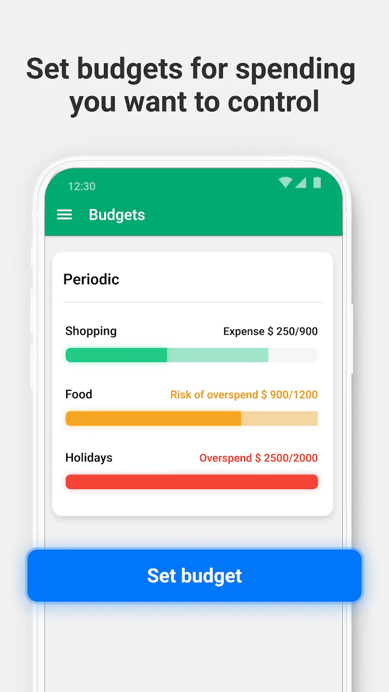
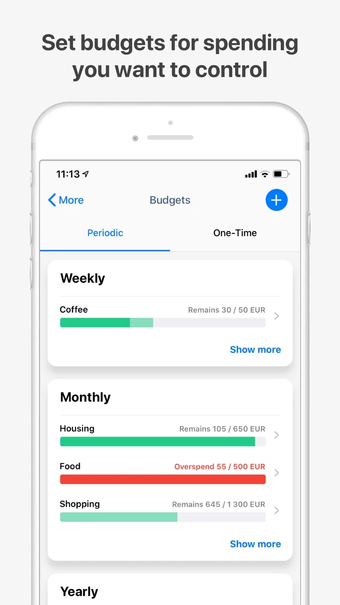

大多数「预算功能对比」停在「支持分类预算、有图表、能提醒」这一层，但真正决定一款记账应用是否好用的，是三个更底层的问题：**预算对象是什么**、**周期边界怎么切**、**没花完的钱去哪了**。同样是「餐饮预算 2000 元」，在 YNAB 里是一个持续累积的类别余额，在 Goodbudget 里是一个信封的运行余额，在喵窝记账里则是一个随日期自动移动的时间窗——三者对「超支」的定义完全不同。

本文只谈预算功能，选取 7 款主流记账应用逐一拆解预算机制：**YNAB**、**Monarch Money**、**Goodbudget**、**EveryDollar**、**PocketGuard**、**Wallet by BudgetBakers** 与 **Meow Money Manager（喵窝记账）**。

> 阅读前提：本文主要对**预算功能**做深度剖析；至于记账软件的其他功能（银行同步、报表、账单管理、多币种等），本文不作过多比较与分析。

如果对记账应用的整体功能对比也感兴趣，可以延伸阅读：[Meow Money Manager vs YNAB：哪款记账应用适合你？](/zh/posts/vs-meow-money-and-ynab/)、[2026 年最佳 Mint 替代应用](/zh/posts/alternatives-to-mint/) 与 [最佳安卓记账与开销追踪应用（2026）](/zh/posts/pillar-budget-expense-tracker-apps-android/)。

## 一览：7 款应用的预算机制速查

| 应用 | 预算对象 | 周期模型 | 结转语义 | 非月度支出 | 核心算式 |
|---|---|---|---|---|---|
| **喵窝记账** | 单条预算（总预算或按支出类别分别设额） | 日 / 周 / 月 / 年 / 自定义，**滚动时间窗** | 无，每次按当天重算窗口 | 自定义起止日期 | 剩余日均 = 剩余额 ÷ 剩余天数（超支按 0） |
| **YNAB** | 类别 + Target（目标） | 日历月 | 正余额滚存；负余额清零并另行处理 | Yearly / Weekly / Custom Target | 收入 − 已分配 = Ready to Assign |
| **Monarch Money** | 类别预算或 Fixed / Non-monthly / Flex 三桶 | 日历月 | 结余与超支**都**滚存 | Non-monthly 目标额 + 频率 | 上月滚存 + 本月计划 − 本月实际 = 下月滚存 |
| **Goodbudget** | 信封（Regular / Annual / Goal） | 周 / 半月 / 月等预算周期 | 运行余额，由填充方式决定 | Annual / Goal 信封 + 到期日 | (目标额 − 已填金额) ÷ 到期前周期数 |
| **EveryDollar** | 分类与预算条目（line item） | 日历月，每月新建 | 无滚存，每月从零开始 | Sinking funds（偿债式储蓄） | 收入 − 支出 = 0 |
| **PocketGuard** | 类别预算 | 日历月 | 结余加到下月、超支从下月扣 | 目标与债务偿还计划 | In My Pocket = 收入 − 账单 − 必需 − 目标 |
| **Wallet** | 按类别 / 账户 / 标签定义的预算 | 周 / 月 / 年 / 自定义；周期性或一次性 | 未用金额滚存 | 周期性预算 + 预定付款 | 剩余 = 预算 − 已花；另有预测支出 |

一眼可见的分野：**YNAB、EveryDollar、Goodbudget 是「分配型」预算**（先把钱放进格子，再花）；**Monarch、PocketGuard、Wallet 是「计划型」预算**（先定支出上限，再对照实际）；**喵窝记账是「限额型」预算**（给一个时间窗和额度，持续汇报还剩多少、每天还能花多少）。三类没有优劣，只有适用场景不同。

---

## 先把评估框架立起来：预算功能的六个技术分歧点

### 1. 预算对象：是「账户余额」还是「支出上限」

YNAB 与 Monarch 官方都明确把自己定位为**现金流预算**而非账户余额预算。Monarch 的帮助文档写得很直白：预算基于当月预期收入构建，收入减去支出与储蓄形成平衡式 `income = expenses + savings`；账户余额主要用于长期目标，不用于日常开支决策。YNAB 则把「Ready to Assign」（待分配）置于整个计划顶部，所有类别的 Available 之和必须能被这笔钱解释。

喵窝记账走的是相反路线：它没有「分配」动作，也不需要录入预期收入。一条预算就是「某个时间窗内，某组支出最多花多少」，总预算给一个总额度、分类预算给每个类别一个额度，已花金额随记账实时更新。这意味着它**不要求你先规划收入**，但也无法回答「这个月还有多少钱可以分配到储蓄」。

### 2. 周期边界：日历月、预算周期，还是滚动窗口

绝大多数应用以**日历月**为预算周期，因为它与工资、房租、账单对齐。EveryDollar 每月新建一张[零基预算](/zh/glossary/what-is-zero-based-budgeting/)表；YNAB 与 Monarch 每月执行一次 rollover；PocketGuard 的分类预算按月重置（除非开启滚存）。

Goodbudget 更灵活，它让你选择「主预算周期」（月、半月、周等），Annual 信封的每月建议填充额就是「年预算 ÷ 一年中的预算周期数」——月周期是除以 12，半月周期则会出现除以 24 的情形，官方示例里也出现了除以 8 的半月度计算。

**滚动时间窗**不以日历月为期：不会分别为 11 月、12 月各建一条预算，而是一条月预算按当前日期自动确定本月起止、到期后自动续到下一期。好处是零维护、自动续期；代价是没有历史月度额度快照，也无法回看「上个月我给自己定了多少」。

### 3. 结转语义：这是最容易踩坑的一处

同样叫[预算滚存](/zh/glossary/what-is-budget-rollover/)（rollover），四款产品的行为完全不同：

- **YNAB**：月末正的 Available 原样保留；负的 Available **不**以负数带到下月，而是显示为灰色 0。现金超支（红色）从下月 Ready to Assign 里扣掉；信用卡超支（黄色）转化为信用卡还款类别的欠款，需要直接给该类别分配资金。官方 FAQ 甚至明确回答「报销款能否让超支结转到下月？不能」。
- **Monarch**：正负都滚存，且给出显式公式 `上月滚存 + 本月计划 − 本月实际 = 下月滚存`。官方示例：上月超支 25、本月计划 100、实际花 50，则下月滚存 25。滚存**只能用于支出类别，不能用于收入类别**。
- **PocketGuard**：未花完的金额加到下月同一类别的额度上，超支则从下月额度里减去。
- **Goodbudget**：信封是持续运行余额，不按月清零；是否清零取决于你选「Add」还是「Set」填充（下文详述）。
- **EveryDollar、喵窝记账**：没有滚存概念，每月/每期重新起算。

### 4. 非月度支出：年费、保险、节日礼物怎么摊

这是区分「够用」与「好用」的分水岭。

- YNAB 用 **Yearly Target**：把年额摊成每月的分配提示；配合 `Set aside another` 行为让钱逐月累积。
- Monarch 用 **Non-monthly 桶**：为类别设置目标额与频率，系统自动算月提存。官方示例是每 6 个月付 600 美元保险，系统算出每月 100 美元，并让 100 逐月滚存为 200、300、400、500、600，付款后归零再来一轮。`variable` 频率则不做自动计算，由你自己决定每月存多少。
- Goodbudget 用 **Annual / Goal 信封 + 到期日**，公式见下文。
- EveryDollar 用[专项基金](/zh/glossary/what-is-a-sinking-fund/)（sinking funds）：官方建议「把总费用除以到期前的月数，逐月存一点」。
- Wallet 用周期性预算配合预定付款与预测支出。
- 喵窝记账用 **自定义起止日期**：你可以为「十一假期」建一条 10 月 1 日到 10 月 7 日的预算，但它不会自动把年度目标摊到每月。

### 5. 「还剩多少」到底怎么算

不同应用给出的数字长得像，含义差很远：

- **剩余额**：喵窝记账 `预算 − 已花`；Wallet `预算 − 已花`；Monarch 显示 `Remaining` 且可能在滚存开启时包含上月余额。
- **可安全花的钱**：PocketGuard 的 In My Pocket 是「收入减去账单、必需品、储蓄目标之后剩下的钱」，包含时间维度（不会牺牲明天的预算）。
- **进度口径**：喵窝记账的进度条显示的是**剩余百分比**（剩余额占总预算的比例），不是已花百分比；Monarch 用绿/黄/红三色加一个「当月进度刻度」，黄色表示按当前速度会在月底超支；PocketGuard 的 Spending Pace 给出 On Pace / Under Pace / Over Pace 三态；YNAB 的 Target 用绿色表示达标、黄色表示待补足。
- **按天折算**：「剩余日均预算」把剩余额除以剩余天数；YNAB 与 EveryDollar 都不做这件事，它们靠「每一块钱都有去处」来控制节奏。

### 6. 数据来源：自动同步还是本地手动

YNAB、Monarch、PocketGuard、Wallet 都以银行自动同步为主要数据来源（PocketGuard 明确写明使用 Plaid、Finicity、Salt Edge，覆盖美、加、英；Wallet 宣称可连接 15000 家以上银行）。EveryDollar 免费版完全手动，Premium 才自动导入。Goodbudget 支持从银行导入交易，但核心仍是手动信封管理。喵窝记账**在设计上就不连接银行账户**，全部记录手动或按周期自动生成，数据留在设备本机。

这直接决定了预算的「实时性」与「隐私成本」：自动同步的预算几乎不需要维护，但要交出账户读权限；本地手动的预算需要每天花十几秒记账，但没有任何云端账本。

---

## 7 款应用逐款拆解

### Meow Money Manager（喵窝记账）：滚动周期与剩余日均预算

它的预算不要求先规划收入，也不做「把钱分配到各类别」这一步：你给一个时间窗和一个额度，它持续汇报还剩多少、按剩余天数每天还能花多少。下面按功能拆解。

<!-- 喵窝截图 1/3：已复用站内 budget_manage.webp；如需换成新版 UI 截图，由作者替换同名文件 -->
{: width="180" .normal }
{: width="180" .normal }
<!-- 喵窝截图 3/3：已复用站内 budget_add_category.webp；如需换成新版 UI 截图，由作者替换同名文件 -->
{: width="180" .normal }

#### 两种预算形态：总预算与分类预算

一条预算可以设成**总预算**：给整个时间窗设一个额度，覆盖窗内全部支出；也可以设成**[分类预算](/zh/glossary/what-is-a-category-budget/)**：选若干支出类别，每类单独设额度，总额即各类额度之和。它不支持「总预算下再挂子预算」的两层结构，**选择的类别数量没有上限**。

分类预算支持父子类别：选中「餐饮」这个父类时，其下「早餐」「外卖」等子类的支出会自动汇总进来，不必逐个勾选。已花金额按当前时间窗统计，窗口变化时数字随之更新。

#### 五种周期与滚动时间窗

周期有**日、周、月、年、自定义**五种。自定义周期可以指定起止日期，起始日不能晚于结束日；一周和一月的起始日也能自行设定，因此「每月 25 日发薪、按 25 日到次月 24 日算一个月」这类安排可以直接对上。

它采用**滚动时间窗**：本期起止按当前日期自动确定，一条月预算会自动延续到下一个月，不需要每月重建，也不会为下一期自动新建一条预算。好处是零维护；代价是没有历史月度额度快照，回看不了「上个月我给自己定了多少」。

#### 剩余天数与剩余日均预算

剩余天数按周期分别计算：日预算为 1 天，周预算为本周剩余天数，月预算为当月剩余天数（受自定义月起始日影响），年预算为年内剩余天数，自定义周期为区间内剩余天数，且不会为负。

在此基础上给出**剩余日均预算**：用剩余额除以剩余天数，保留 4 位小数、四舍五入。若已经超支，按 0 计算，不会出现「每天还能花 −12.5 元」；到了周期最后一天或周期已过期，则直接显示剩余额，不再做除法。

进度条显示的是**剩余占比**而不是已花占比，剩余越少条越短，超支时进度条清空——方向与多数应用相反，读的时候别把「进度条短」理解成「才刚开始花」。

#### 已花金额的计算口径

总预算汇总时间窗内的全部支出，报销差额与转账手续费也计入这个口径，不是简单的「支出合计」。

分类预算按类别归集，其中有两个容易被忽略、但直接影响数字准确性的细节：

1. **父子类别自动汇总**：选父类即可覆盖其下所有子类，不必逐项勾选。
2. **报销按未报销净额计入**：一笔已全额报销的差旅支出，不再占用预算额度；只报销一部分时，按尚未报销的部分计入。

对经常垫付差旅费的人，第二点比「把报销当成一笔收入」要准确得多，也是这 7 款里少见的口径。统计范围始终与当前周期窗口一致。

#### 创建规则、免费额度与桌面小组件

创建一条预算需要选周期、填名称、给金额：总预算金额必须大于 0，分类预算里每个类别的额度都必须大于 0；自定义周期还要填起止日期。分类预算目前**只覆盖支出类别**，收入类别无法单独设预算。

免费版最多创建 **3 条预算**，第 4 条起需要解锁 VIP；但单条预算能选几个支出类别没有限制。分类项支持拖拽排序，顺序会随预算一起保存。新增、编辑或删除预算后，桌面小组件会同步刷新，每条预算独立显示总额与剩余额。

#### 明确的能力边界

它没有跨期滚存、不会按周期自动生成多期预算、没有预算级多币种（多币种是全局货币符号与多账本能力，不是预算维度）、没有超支推送通知、预算共享、历史趋势图、收入类别预算，也没有预算模板与目标额自动摊分。它的定位是一个离线、轻量、口径清晰的**限额看板**，不是一套预算方法论。

### YNAB：目标驱动 + 现金与信用双轨超支

{: width="180" .normal }
{: width="180" .normal }

YNAB 的预算单位是**类别 + Target**。Target 有两个维度：

- **类型**决定重复频率：`Monthly`（每日历月）、`Yearly`（把年额摊成每月储蓄提示）、`Weekly`（每月内按周重复）、`Custom`（不符合标准节奏的支出）。
- **行为**决定重置时提示什么：`Set aside another` 每期都要求分配完整目标额，即使上月有结余——适合需要逐月累积的储蓄与非月度支出；`Refill up to` 只要求补足到目标额，上月结余可抵扣——适合「每月最多花这么多」的支出类别。

进度用绿色（达标）与黄色（待补足）呈现。设置 Target 后，YNAB 会在每次发薪时提示你给该类别分配资金，并可基于已有消费史自动创建部分 Target。

月度结转是 YNAB 最精密也最容易被误解的部分。官方《When the Month Rolls Over》给出四条规则：

1. 正的 Available **不变**，原样留在新月；
2. 负的 Available 在新月显示为**灰色 0**，不再以负数形式存在；
3. Assigned 列**重置为 0**（除非你已把钱分配到未来月份）；
4. 现金超支（红色负数）从新月 Ready to Assign 中扣除；信用卡超支（黄色负数）转化为信用卡还款类别的 Underfunded 提示，需要直接给该类别分配资金来还债。

若 Ready to Assign 月末仍有余额且无现金超支，则原样滚入新月；有现金超支时先抵扣，剩余部分再滚入。`Overspending in YNAB` 还补充说明：同一类别里现金与信用卡消费混合时，YNAB 按现金优先记账，因此负数显示为红色。

**适配人群**：愿意学习一套方法论、希望主动规划每一块钱、且能接受订阅费的人。**不适配**：只想看「这个月还剩多少」的人。

### Monarch Money：两套预算体系 + 公式化滚存

{: width="180" .normal }
{: width="180" .normal }

Monarch 同时提供 **Category**（传统分类预算，每个支出类别一个额度）与 **Flex**（默认）两套模式，可随时切换且各自设置会保留。

Flex 把支出归为三个高层桶：

- **Fixed**：房租、水电、订阅、月保费等每月稳定且不易削减的支出，桶总额月月相同；
- **Non-monthly**：一年至少发生一次、可预期但非每月的支出（年费订阅、车辆保养、节日礼物），**必须开启滚存并设置目标额与频率**才能正常工作；
- **Flex**：餐饮、娱乐、购物等波动最大、也最容易削减的支出，只跟一个总额数字对照。

首次建预算时，Monarch 按**过去 6 个月**各类别支出的平均值自动预填，也可随时用 `Recalculate default budgets` 重算。类别体系有三层：Type（Income / Expenses / Transfers，不可改）→ Group → Category，默认约 60 个类别，可自定义、停用或从预算中排除（排除后仍计入现金流与支出总额）。

滚存规则由官方给出明确公式：

> **上月滚存 + 本月计划 − 本月实际 = 下月滚存**

官方示例：上月超支 −25、本月计划 100、实际 50，则下月滚存 25。可为单个类别设 `Starting Balance` 与 `Starting Month` 来补记历史储蓄。三条重要限制：滚存**只能用于支出类别，不能用于收入类别**；Fixed 与 Non-monthly 桶内类别的滚存会同时影响类别与桶的 Remaining，而 **Flex 桶内类别的滚存只影响类别层，不影响 Flex 桶总额**；Flex 桶的数字本来就不等于其下类别预算之和，因为很多类别根本没有单独额度。

Non-monthly 的摊分由「目标额 ÷ 频率」自动完成：600 美元、每 6 个月一次 → 每月 100 美元，逐月滚存累积到 600 后付款归零。频率选 `variable` 时不做自动计算。

呈现上，网页端是 Planned / Actual / Remaining 三列，移动端默认两列（可长按数字切换）；进度条用绿（在预算内）、黄（按当前速度会在月底超支，仅出现在 Flexible 条）、红（已超支）三色，并有一个表示「今天是本月第几天」的刻度线。支持把钱从有余的类别移到超支类别（Flex 模式下只能在桶级移动）、CSV 导出（仅网页端，含当前月份）、iOS 预算小组件、预算日历视图与通知。

**适配人群**：既想要分类预算的控制力，又不想逐类维护额度的用户。**不适配**：收入波动极大或坚持纯零基方法的人。

### Goodbudget：信封运行余额与两种填充语义

{: width="180" .normal }
{: width="180" .normal }

Goodbudget 用的是[信封预算法](/zh/glossary/what-is-envelope-budgeting/)：把预算实现为**信封余额**，且是**运行余额**。官方明确说明，信封余额不受单个月份限制，任何过去或现在的交易都会影响今天的余额。这是它与 YNAB、Monarch 最根本的差别——不是「每月一张表」，而是「一直往里存、一直往外花」。

信封分三类：

- **Regular Envelope**：按主预算周期（月 / 半月 / 周）填充的日常支出；
- **Annual Envelope**：每年重复的大额支出（房产税、节日礼物），给定年预算与到期日；
- **Goal Envelope**：一次性目标（婚礼、买车），给定目标额与到期日，达成即结束。

新周期开始时执行「Fill（填充）」，两种方式的差异极其具体。官方示例：一个预算 50.00 的信封，期末剩 5.00——

- `Add budgeted amount`：**滚存 5.00 再加 50.00**，新周期从 **55.00** 开始；
- `Set to budget amount`：**只补足到 50.00**，即补 45.00，新周期从 **50.00** 开始。

因此「超支会不会带到下月」在 Goodbudget 里不是产品设定，而是用户每次填充时的选择。也可设置按每月 1 日重复执行的预定填充来自动化。若想让信封每月都从预算额开始、不累积结余，官方另有「每月自动重置信封余额」的做法。

Annual / Goal 信封的建议填充额有明确公式（官方帮助页）：

- 无到期日的 Annual：年预算额 ÷ 一年中的预算周期数（月周期即 ÷12）；
- 无到期日的 Goal：**始终为 0**；
- 有到期日的 Annual 或 Goal：`(年预算额或目标额 − 已 Fill 或 Transfer 进该信封的金额) ÷ 到期前的预算周期数`。官方示例：目标 1200、4 个月后到期、从未填充、月周期 → `(1200 − 0) / 4 = 400`；改为半月周期且已填 50 → `(1200 − 50) / 8 = 143.75`。

一个反直觉但很重要的细节：**公式不考虑当前余额**。即使你已经把存进去的钱花掉了一部分，之前填充过的金额仍会被算作「已完成储蓄」。

免费版额度（官方 Billing 页）：**10 个 Regular 信封 + 10 个 Annual/Goal 信封 + 1 个账户 + 2 台设备 + 1 年历史**，免费版可无限期使用；Premium 为 **10 美元/月或 80 美元/年**，解锁无限信封等。官方也建议为每类非月度支出单独建信封，并把总费用除以到期前月数逐月存。

**适配人群**：喜欢「信封法」、愿意每月花几分钟做一次填充动作、且支出类别不多的人。**不适配**：分类超过 20 个、或不愿手动维护余额的人。

### EveryDollar：严格的月度零基预算

{: width="180" .normal }
{: width="180" .normal }

EveryDollar 的预算模型简单到可以用一句话写完：**收入 − 支出 = 0**。你在月初录入全部收入，再逐条列出捐赠、储蓄、支出，直到差额为 0；官方称此时页面顶部会出现绿色对勾与「It's an EveryDollar budget!」。官方示例是月收入 3000：捐赠 300、储蓄 300、住房与水电 1300、餐饮 450、交通 400、其他 250，合计正好 3000。

它按**月**建表，每月都是一次重新开始，官方也把「每个月都是新的机会」写进新手建议里——这意味着它不是滚存型预算，超支与结余都不会自动进入下月的额度计算。月中计划有变时，官方建议直接在预算条目之间移动资金，移动后仍需保持「每一块钱都有去处」。

**免费版**（官方 Ramsey 文章，2026-11-05 更新）包含：创建月度预算、电脑/手机/平板访问、手动记录交易、自定义分类与预算条目、**无限数量的分类与条目**、目标设定与追踪、sinking funds、拆分交易到多个条目、账单到期日、人工客服。**Premium 79.99 美元/年**追加：连接多个金融账户、交易自动流入并拖放到预算条目、按发薪日规划支出（paycheck planning）、一键交易归类建议、账单到期提醒、自定义收支报表、CSV 导出、直播教练课程、当前与预测净资产、财务路线图。

对非月度支出，官方给的是**手工摊分**：为每笔年度/偶发支出建一个 sinking fund，把总费用除以到期前的月数，每月存一点。它与 YNAB 的 Yearly Target、Monarch 的 Non-monthly 桶解决同一问题，但没有自动计算与自动滚存。可与配偶共用一个账号共同预算。

**适配人群**：想严格实践零基预算、偏好「简单到没有隐藏规则」的人。**不适配**：需要跨月累积储蓄、或希望系统替你算年度支出摊分的人。

### PocketGuard：从「可安全花的钱」倒推预算

{: width="180" .normal }
{: width="180" .normal }

PocketGuard 的预算不是从「类别」起步，而是从**一个数字**起步：In My Pocket（官方也用 Leftover / Safe-to-spend 表述），即扣除账单、必需品、储蓄目标与债务后，今天可以安全花掉的钱。Google Play 官方描述把它拆成三层：收入与支出之后的实时预算余额、扣除账单/目标/必需品后的可安全花费金额、以及「不会伤害明天预算」的日常可用额。

**Category Budget** 则在这个数字之上做预留：官方帮助页说明，创建分类预算时 PocketGuard 会为该类支出**预留资金并从 In My Pocket 中扣除**；把收入逐类分配完，就能构造出一张零基预算表。官方功能页也明确列出支持零基、分类、信封式与 50/30/20 多种风格。

**Rollover** 是逐类别生效的：某类没花完，余额加到下个月同一类别的额度上；某类超支，差额从下月额度里减去。因此它同时保留结余与赤字，与 YNAB「只滚正余额」形成鲜明对照。

**Spending Pace** 是它最有辨识度的预算机制：系统结合账单与消费习惯，在月底之前就判断你是否会超支，给出 `On Pace`（符合月度计划）、`Under Pace`（低于预期）、`Over Pace`（支出加速、可能超预算）三态。另有交易规则自动归类、可按「Don't count」把交易排除在预算之外、月度预算表现对比与趋势分析、账单与订阅识别、债务偿还计划。

价格（Google Play 官方 FAQ，2026-10-28 更新）：核心功能免费但预算数量受限；**PocketGuard Plus 7 天试用后 12.99 美元/月或 74.99 美元/年**，解锁无限预算、交易规则、债务偿还计划等。银行连接覆盖美国、加拿大、英国；也可以**完全不连银行、手动录入**。

> 说明：PocketGuard 官网与帮助中心在部分地区会返回地域限制页，本文的滚存与分类预算规则取自其官方帮助页摘要、官方功能页文案与 Google Play 官方应用描述交叉核对。

**适配人群**：最关心「今天还能不能花这笔钱」、容易被分类预算表劝退的人。**不适配**：需要复杂目标管理与多币种的用户。

### Wallet by BudgetBakers：按类别、账户或标签定义预算

{: width="180" .normal }
{: width="180" .normal }

Wallet 的预算**不是按「一个类别一条」组织，而是按「筛选条件」组织**。官方帮助页给出三种定义方式：选择特定类别（官方推荐）、选择特定账户、选择自定义标签。凡是匹配该条件的记录都计入这条预算，因此官方特别提醒**避免预算之间重叠**（例如同一个类别被两条预算包含），否则统计会难以解读。

周期与形态上，官方功能页列出：**周期性（recurring）与一次性（one-time）预算**、按类别追踪、**未使用金额滚存**；预算页进一步写明可建**月、周或自定义周期**的预算，并有接近上限提醒、历史趋势分析。预算卡片展示 Spent（已花）、Remaining（预算 − 已花，以默认货币计）与 Forecast spending（预测整个周期结束时的花费）。这在 7 款产品里是唯一把「按当前轨迹预测期末支出」作为预算卡片一等信息的做法。

多币种是 Wallet 相对其他几款的明显优势：官方功能页列出 **170+ 币种、实时汇率**，帮助中心说明每种货币需建独立账户、汇率夜间自动更新，也可关闭自动更新手动设定。家庭共享支持共享账户、分摊支出与隐私控制。官方功能页还列出 15000+ 银行同步、CSV/PDF 报表、iOS / Android / Web 跨平台。

有三点限制值得注意：**预算功能在 Web 版尚不可用**，只能在 Android（主侧边菜单）与 iOS（底部「规划」标签）使用；免费版主要是手动记账，银行同步、家庭共享等自动化能力需要 Premium；官方不在官网公开 Premium 价格，需在应用内查看。

**适配人群**：多币种账户、需要家庭共享预算、或想按账户/标签而非类别切分预算的人。**不适配**：只想在网页上管理预算的人。

---

## 关键维度深度对比

### 结转语义对照：同一个词，四种行为

| 应用 | 正余额（结余） | 负余额（超支） | 是否可关闭 | 是否作用于收入类别 |
|---|---|---|---|---|
| 喵窝记账 | 不滚存，周期结束即重算窗口 | 不滚存 | 无此概念 | 不支持收入预算 |
| YNAB | 原样保留在下月 Available | 清零为灰色 0，现金超支扣下月 Ready to Assign；信用超支转信用卡欠款 | 不可关闭 | 不适用 |
| Monarch | 计入下月滚存 | 以负数计入下月滚存 | 可按类别开关 | **否**，官方明确禁止 |
| Goodbudget | 取决于 Add / Set 填充 | 取决于 Add / Set 填充 | 由每次填充方式决定 | 不适用（信封为支出） |
| EveryDollar | 不滚存，每月新建 | 不滚存 | 无此概念 | 收入是预算输入项 |
| PocketGuard | 加到下月同类额度 | 从下月同类额度扣减 | 可按预算开关 | 不适用 |
| Wallet | 未使用金额滚存 | 官方未明确超支处理 | 未明确 | 预算以支出为主体 |

**怎么读这张表**：如果你在攒一笔半年后要付的钱，「正余额必须能滚存」是硬需求——喵窝记账与 EveryDollar 直接出局，Goodbudget 需要你选 `Add` 填充，YNAB 需要 `Set aside another` 或 Yearly Target，Monarch 需要开滚存并设目标频率，PocketGuard 与 Wallet 原生支持。反过来，如果你希望每个月都是干净的一张表、不想让上个月的超支持续污染下个月，YNAB 与 EveryDollar 的「清零」语义反而更省心；按时间窗重新起算的做法同理，一期超支不会压低下一期的额度，账面也更容易对上。

### 非月度支出摊分：自动计算 vs 手工估算

| 应用 | 机制 | 是否自动算每期应存 | 是否自动累积到目标额 |
|---|---|---|---|
| 喵窝记账 | 自定义起止日期预算 | 否 | 否 |
| YNAB | Yearly / Weekly / Custom Target + `Set aside another` | 是（年度目标摊月提示） | 是（余额持续累积） |
| Monarch | Non-monthly 桶：目标额 + 频率 | **是**（600 ÷ 6 = 100/月） | **是**（滚存到 600 后付款归零） |
| Goodbudget | Annual / Goal 信封 + 到期日 | **是**（(目标 − 已填) ÷ 到期前周期数） | 是（信封余额） |
| EveryDollar | Sinking funds | 否（官方建议手工除以月数） | 是（基金余额） |
| PocketGuard | 目标 + 滚存 | 未明确自动摊分 | 是（分类滚存） |
| Wallet | 周期性预算 + 预定付款 + 预测支出 | 未明确自动摊分 | 是（未用金额滚存） |

Monarch 与 Goodbudget 是这一项上最完整的两家：都给出**可复算的公式**、都考虑了到期日、都处理了「已经存过一部分」的情形。差别在于 Goodbudget 的公式**不扣减当前余额**（花掉已存的钱不会让建议填充额回升），Monarch 则直接以 `实际支出` 参与滚存计算，语义更接近会计口径。反过来说，若支出集中在一个明确的短区间——一趟旅行、一次装修——直接给这个区间设一条预算，比把年额摊到每个月更省事。

### 计算口径对照：进度条到底在说什么

| 应用 | 主数字 | 进度/状态 | 按天折算 | 预测期末 |
|---|---|---|---|---|
| 喵窝记账 | 剩余额、剩余天数、**剩余日均** | 剩余百分比（超支归 0） | **有** | 无 |
| YNAB | Available、Ready to Assign | Target 绿 / 黄 | 无 | 无 |
| Monarch | Planned / Actual / Remaining | 绿 / 黄 / 红 + 当月进度刻度 | 无 | 有（Forecast，功能页） |
| Goodbudget | 信封运行余额 | 信封余额本身 | 无 | 无 |
| EveryDollar | 预算条目剩余额 | 无进度条（零基对勾） | 无 | 有（净资产预测，Premium） |
| PocketGuard | In My Pocket | Spending Pace 三态 | 无 | 有（Pace 趋势） |
| Wallet | Spent / Remaining / Forecast spending | 接近上限提醒 | 无 | **有** |

「剩余日均」把剩余额与剩余时间绑在一起，直接回答「今天能花多少」，当期剩余与每天可用额同屏可见，不必先规划收入、也不必自己再除一次。但它也带来一个副作用——**剩余天数变化时，日均会跳变**。例如月预算在月初 1 号剩 3000 元、剩 30 天 → 日均 100；到月中剩 1500 元、剩 15 天 → 日均仍是 100（线性消耗时稳定），但一旦某天大额消费，日均会立刻下降且不会在后续回弹。这是限额型预算的固有特性，不是缺陷，但读者需要理解它**不是预测**，只是当前余额的算术均分。

### 分类层级、口径与数据边界

| 应用 | 分类层级 | 是否支持标签/账户维度 | 排除交易 | 报销口径 | 多币种 |
|---|---|---|---|---|---|
| 喵窝记账 | 父 / 子类别，子类自动汇总到父 | 账本（多账本，非预算维度） | 转账手续费等计入总预算汇总 | **按未报销净额计入预算** | 50+ 符号、多账本（全局） |
| YNAB | 类别组 / 类别 | 否 | 可隐藏类别 | 有独立报销做法（不改变超支结转） | 有限 |
| Monarch | Type / Group / Category 三层 | 否 | **可按类别排除预算**（仍计入现金流） | 无专门口径 | 有限 |
| Goodbudget | 信封 / 信封组 | 账户（Account） | 无 | 无 | 有限 |
| EveryDollar | 分类 / line item | 否 | 无 | 无 | 有限 |
| PocketGuard | 自定义类别 | 交易规则 | **`Don't count` 排除预算** | 无 | 有限 |
| Wallet | 类别 | **类别 / 账户 / 标签三选一** | 可通过规则避免计入 | 无 | **170+ 币种、实时汇率** |

按**未报销净额**计入预算，是 7 款里少见的做法：已全额报销的差旅支出不再占用预算额度，只报销一部分时只计未报销的部分。对经常垫付差旅费的人，这比「把报销当作一笔收入」要准确得多。而 Monarch 的「从预算排除但仍计入现金流」、PocketGuard 的 `Don't count`、Wallet 的标签维度，代表的是另一种灵活性：**决定哪些交易根本不参与预算**。

### 隐私、价格与共享

| 应用 | 账号与数据 | 银行同步 | 预算共享 | 免费额度 | 付费价格（官方口径） |
|---|---|---|---|---|---|
| 喵窝记账 | 无需账号，本机存储，可备份到自己的云盘 | 无（设计如此） | 无 | 最多 3 条预算 | 一次性 VIP |
| YNAB | 云端账号 | 自动 | 支持与伴侣共用计划 | 无免费版 | 109 美元/年（Ramsey 对比表引用） |
| Monarch | 云端账号 | 自动 | 支持 | 无免费版 | Core 99.99 / Plus 199.99 美元/年（Ramsey 对比表引用） |
| Goodbudget | Household 账号 | 可导入 | 最多 2 台设备共享一份预算 | 10 + 10 信封、1 账户、2 设备、1 年历史 | 10 美元/月，或 80 美元/年 |
| EveryDollar | 云端账号 | 仅 Premium | 与配偶共享一个预算 | 无限分类 + sinking funds | 79.99 美元/年 |
| PocketGuard | 云端账号 | 自动（也可纯手动） | 未作为预算特性强调 | 核心免费，预算数量受限 | 12.99 美元/月，或 74.99 美元/年 |
| Wallet | 云端账号 | 自动（Premium） | 家庭共享预算 | 手动记账 | 官网不公开，应用内查看 |

这一栏里，无需账号、无银行连接、无共享是一组明确的取舍，换来数据不出设备与一次性付费；其余 6 款多以云端账号与自动同步为默认，账本与银行读权限都要交给服务商。**如果关注隐私，可以直接选喵窝记账**：7 款里只有它既不需要账号、也不授权银行读取、更不把账本上传云端，记录始终留在本机，备份也能放进自己的云盘，数据暴露面最小，隐私安全上最稳妥。把它与 YNAB 放在一起比「谁更值」意义不大——两者出售的是两样东西：一套改变行为的方法论，和一个不打扰你的本地账本。

---

## 你该选哪个

- **只想回答「今天还能花多少」**：选 **Meow Money Manager**。剩余日均、剩余天数与主屏小组件直接给出答案；不要求先规划收入，也不需要注册账号或连接银行账户，周/月的起始日还能按发薪日调整。前提是接受手动记账与「无滚存」。
- **愿意用方法论换控制力**：选 **YNAB**。Target 的两类行为、现金/信用双轨超支、Ready to Assign 的严格口径，构成了一套完整的分配型预算模型。
- **既想分类、又不想逐类维护**：选 **Monarch Money**。Flex 三桶把「需要精细管理」和「只看总数」的支出分开，Non-monthly 的频率摊分是本文里最自动化的实现。
- **信封法信徒、支出类别不多**：选 **Goodbudget**。运行余额 + Add/Set 两种填充，把结转的控制权完全交给你；但先确认 10 + 10 个信封够用。
- **严格零基、越简单越好**：选 **EveryDollar**。免费版就给了无限分类与 sinking funds，代价是非月度支出要自己算、每月要重建预算。
- **最怕超支、想看「安全花费额」**：选 **PocketGuard**。In My Pocket 加 Spending Pace 三态，在月底之前就能预警，而不是事后告诉你超了。
- **多币种、家庭共享、想按标签切预算**：选 **Wallet by BudgetBakers**。170+ 币种与类别/账户/标签三种定义方式是 7 款中少见的组合，但预算功能目前只在手机端。
- **经常垫付差旅费**：看预算是否按未报销净额计。已全额报销的支出不占额度，其余应用多把报销当收入或另设流程。

**务实组合**：把限额型工具用于日常记录与差旅报销，把分配型工具用于年度支出摊分与共同规划，两者各管一段。如果日常只关心本期还剩多少、也不打算为年度支出单独攒钱，前者已经够用，不必再叠加一套分配流程。并行使用时不要试图让「剩余额」对上——口径本来就不同。

### 各应用官方下载

7 款应用均提供 Android 与 iOS 版本，下表为各自官方商店页面。

| 应用 | Android | iOS |
|---|---|---|
| Meow Money Manager（喵窝记账） | [Google Play](https://play.google.com/store/apps/details?id=com.glgjing.money.manager.bookkeeping.meow) | [App Store](https://apps.apple.com/us/app/meow-money-manager/id1528852284) |
| YNAB | [Google Play](https://play.google.com/store/apps/details?id=com.youneedabudget.evergreen.app) | [App Store](https://apps.apple.com/us/app/ynab/id1010865877) |
| Monarch Money | [Google Play](https://play.google.com/store/apps/details?id=com.monarchmoney.mobile) | [App Store](https://apps.apple.com/us/app/monarch-budget-track-money/id1459319842) |
| Goodbudget | [Google Play](https://play.google.com/store/apps/details?id=com.dayspringtech.envelopes) | [App Store](https://apps.apple.com/us/app/goodbudget-budget-planner/id471112395) |
| EveryDollar | [Google Play](https://play.google.com/store/apps/details?id=com.everydollar.android) | [App Store](https://apps.apple.com/us/app/everydollar-budget-management/id942571931) |
| PocketGuard | [Google Play](https://play.google.com/store/apps/details?id=com.pocketguard.android.app) | [App Store](https://apps.apple.com/us/app/pocketguard-budget-app/id949414211) |
| Wallet by BudgetBakers | [Google Play](https://play.google.com/store/apps/details?id=com.droid4you.application.wallet) | [App Store](https://apps.apple.com/us/app/wallet-daily-budget-profit/id1032467659) |

## 常见问题（FAQ）

**同样是「预算结转」，YNAB 和 Monarch 到底差在哪？**
{:.faq-q}

YNAB 只滚存正余额；负余额在新月变灰色 0，现金超支从 Ready to Assign 扣除、信用卡超支转成信用卡还款类别的欠款。Monarch 则把正数与负数都写进同一个公式 `上月滚存 + 本月计划 − 本月实际 = 下月滚存`，超支会直接压低下月额度。前者保护「每月从干净的一张表开始」，后者让债务在数字上无所遁形。

**「剩余日均预算」是怎么算的？**
{:.faq-q}

用剩余额除以剩余天数，保留 4 位小数、四舍五入；已经超支时按 0 计算。剩余天数按周期分别算：日预算固定 1 天，周预算为本周剩余天数，月预算为当月剩余天数（受自定义月起始日影响），年预算为年内剩余天数，自定义周期为区间内剩余天数且不小于 0。剩余天数为 0 时不做除法，直接显示剩余额。

**为什么有的预算进度条显示剩余、有的显示已花？**
{:.faq-q}

它显示的是**剩余占比**（剩余额占总预算的百分比），剩余越少进度条越短；超支时进度条清空。多数应用显示的是已花占比、超支变红。两者只是取数方向不同，读的时候注意别把「进度条短」理解成「才刚开始花」。

**哪款应用能自动把年费摊到每个月？**
{:.faq-q}

Monarch 与 Goodbudget 都给出可复算的公式。Monarch 的 Non-monthly 桶按「目标额 ÷ 频率」算月提存（600 美元 / 6 个月 = 100 美元/月）并逐月滚存；Goodbudget 的 Annual/Goal 信封按 `(目标额 − 已填金额) ÷ 到期前周期数` 算建议填充额。YNAB 用 Yearly Target 配合 `Set aside another` 达到类似效果，EveryDollar 则建议手工把总额除以月数。

**可以给收入类别设预算吗？**
{:.faq-q}

Monarch 官方明确写「滚存只能用于支出类别，不能用于收入类别」，收入在它那里是预算的输入项而非限额对象。Meow Money Manager 的分类预算也**只覆盖支出类别**，收入类别无法单独设预算。

**不连接银行账户，预算还准吗？**
{:.faq-q}

准不准取决于记录是否完整，而不是数据从哪来。PocketGuard 官方 FAQ 明确支持完全手动录入；EveryDollar 免费版本来就是手动；喵窝记账在设计上不连接银行。自动同步省掉录入成本，但分类仍需人工校正（YNAB、Monarch、PocketGuard 都提供规则或建议归类）。手动方案的关键纪律是「当天记」，漏记几笔，剩余额就会偏乐观。

**Meow Money Manager 免费版能建几条预算？**
{:.faq-q}

免费版最多 3 条预算，达到后再点「新增预算」会提示解锁 VIP。但**单条预算能选几个支出类别没有上限**，可以按需要把任意多个类别放在同一条分类预算里。

## 相关术语

- [什么是预算管理？](/zh/glossary/what-is-budget-management/)
- [什么是分类预算（Category Budget）？](/zh/glossary/what-is-a-category-budget/)
- [什么是零基预算（Zero-Based Budgeting）？](/zh/glossary/what-is-zero-based-budgeting/)
- [什么是信封预算法（Envelope Budgeting）？](/zh/glossary/what-is-envelope-budgeting/)
- [什么是预算滚存（Budget Rollover）？](/zh/glossary/what-is-budget-rollover/)
- [什么是专项基金（Sinking Fund）？](/zh/glossary/what-is-a-sinking-fund/)
- [什么是记账应用（Expense Tracker）？](/zh/glossary/what-is-an-expense-tracker/)
- [什么是报销管理？](/zh/glossary/what-is-reimbursement-management/)
