大多数「习惯应用对比」停在「有打卡、有图表、能提醒」这一层，但真正决定一款应用是否好用的，是三个更底层的问题：**一条记录到底代表什么**、**周期的边界怎么切**、**断了一天之后数字怎么变**。同样是「每周运动三次」，有的应用要求你指定周一三五，有的允许一周内任意三天，有的干脆把它当成每两天一次；同样漏打卡一天，有的把连续天数清零，有的只让一个长期分数缓慢下降，有的直接扣掉角色的生命值。

本文先讲清楚**什么是习惯应用、它到底有什么用**，再用六个可以逐项核对的技术分歧点，拆解 7 款主流产品：**喵窝习惯（Meow Habits）**、**Streaks**、**Habitica**、**Loop Habit Tracker**、**Habitify**、**Productive** 与 **Fabulous**。

> 阅读前提：本文主要对**习惯追踪机制**做深度剖析；记账、待办管理、健康数据平台、社群运营等外围能力，只在影响习惯记录口径时顺带提及。文中功能与各应用的额度、付费方式按 2026 年 11 月核对的官方页面与官方商店描述为准，版本更新后请以应用内实际显示为准。

如果你更关心「哪款适合我」而不是「它们怎么算」，可以延伸阅读：[最佳安卓习惯追踪应用（2026）](/zh/posts/pillar-habit-tracker-apps-android/)、[喵窝习惯 vs Streaks：哪款更适合坚持打卡？](/zh/posts/vs-meow-habits-and-streaks/)、[喵窝习惯新手入门](/zh/posts/best-meow-habits-beginners/) 与 [喵窝习惯完整教程](/zh/posts/tutorial-meow-habits/)。

## 一览：7 款应用的习惯机制速查

| 应用 | 一条记录代表什么 | 周期模型 | 断一天会怎样 | 主要统计口径 | 数据归属 |
|---|---|---|---|---|---|
| **喵窝习惯** | 单个周期内一条累计记录：`+1` / `-1` / 输入数值 / 完成 / 跳过 | 每日、每周、每月、指定星期几、每 N 天，配目标值与单位 | 连续次数按有效周期回推；可标记「跳过」不计断签 | 当前连续、最长连续、完成次数、完成率、月历与 365 天热力 | 本机数据库、无账号；CSV 导出，Google Drive / WebDAV 备份 |
| **Streaks** | 任务一次勾选；另有计时任务与「不要做」的负向任务 | 每天、指定星期几、每周若干天，可设休息日 | 漏掉应做的一天，连续天数归零；休息日不打断 | 当前 / 最佳连续、完成率、日历与趋势 | Apple 生态，经 iCloud 同步，不经第三方服务器 |
| **Habitica** | 习惯（即时加减）、每日任务（按日程）、待办（一次性）三类分开 | 每日任务可设每天、每周三次、每月四次等 | 未完成每日任务扣生命值；生命值归零会降级并清空金币 | 等级、经验、金币、角色成长与任务历史 | 账号 + 云端，客户端开源，另有网页版 |
| **Loop Habit Tracker** | 一次勾选；数值型习惯可记录完成量 | 每日、每周 3 次、隔天、隔周等灵活时间表 | 不按「断链即归零」：习惯分数随完成增强、随错过衰减 | 习惯分数、连续天数、完成率、打卡矩阵与图表 | 本机离线、无账号、开源，可导出 CSV 或完整数据库文件 |
| **Habitify** | 一次勾选，习惯按早 / 午 / 晚时段归组 | 每日或指定星期等重复规则 | 以日历与完成率呈现，不把断签惩罚做成核心机制 | 完成率、连续天数、日历与趋势 | 账号 + 跨平台实时同步；免费版限 3 个习惯 |
| **Productive** | 一次勾选，习惯挂在时段与计划下 | 可设重复日与一天多次，配模板库 | 以日历呈现完成与否 | 完成率、里程碑、趋势与进度环 | 账号 + 同步，含挑战与提醒体系 |
| **Fabulous** | 一段例行程序里的每个小步骤逐项完成 | 按「旅程」阶段与晨 / 午 / 晚例行组织 | 不强调连续次数，按阶段推进 | 阶段进度、例行程序完成度与教练内容 | 账号 + 订阅内容库 |

一眼可见的分野：**喵窝习惯、Streaks、Loop、Habitify、Productive 是「记录型」**（先把行为记下来，再谈激励）；**Habitica 是「游戏型」**（记录本身会换算成经验、金币与惩罚）；**Fabulous 是「课程型」**（记录服务于一套分阶段的行为改变方案）。三类没有优劣，只是对「坚持」这件事的假设不同。

---

## 先搞清楚：习惯应用记录的是什么

在比较产品之前，得先把几个反复出现、却很少被解释清楚的概念拆开。这些概念不是术语游戏——你在应用里看到的每一个数字，都由它们决定。

### 一条习惯 = 目标 + 周期 + 一次记录

习惯追踪的最小数据不是「今天运动了」，而是三件事叠在一起：

- **目标**：要做的行为，以及它有没有量化标准。「每天读书」没有目标值，「每天读 30 分钟」有。
- **周期**：这次目标在哪个时间范围内结算。一天、一周、一个月，或者「每逢周一、三、五」。
- **记录**：在该周期内，你对这个目标做了什么——完成、累计了多少、还是明确标记跳过。

理解这一点，就能解释很多困惑：为什么「昨天明明打卡了，今天的连续天数还是 0」？因为昨天属于上一个周期，而今天的周期还没有记录；为什么删掉一条习惯后历史图表也变了？因为统计是按周期聚合的，不是按一条条流水累加的。

### 养成与戒除：同一个进度环，方向相反

多数应用把习惯分成两类：**养成型**（多做，如喝水、阅读、运动）与**戒除型**（少做，如不喝含糖饮料、不熬夜）。两者在界面上往往都是同一个进度环，但判定方向相反：养成型是「达到目标值算完成」，戒除型是「不超过上限算完成」。

喵窝习惯把这一选择放在新建习惯的第一步（「我想」里选养成或戒掉），随后才配单位与目标值；Streaks 则有专门的负向任务，用「不做某件事」来累计连续天数。方向一旦选反，进度环会诚实地告诉你「今天做得越多越糟」。

### 布尔型与数值型目标

最基础的记录只有两个状态：**没做 / 做了**（布尔型）。但很多行为天然带数量：喝水 8 杯、阅读 30 分钟、跑步 3 公里。这类**数值型目标**需要一个单位和一个阈值，记录动作也从「勾一下」变成「加减、输入或直接置为完成」。

这个差别会一路传导到统计：布尔型的完成率只有 0% 或 100%，数值型则可能出现「今天完成 60%」。喵窝习惯在打卡面板里同时给出 `+1`、`-1`、输入数值、完成与跳过五种动作；Loop 的打卡矩阵里也能看到按英里、页数等数值记的习惯；而 Streaks 的主界面以一次勾选为主，另有计时任务负责「持续了多久」。

### 周期：日历日、每周 N 次、指定星期、每 N 天

「每天」是最简单的周期，但现实里的习惯很少这么规整。常见的四种口径是：

1. **日历日**：每天一次，跨过午夜就换一格。
2. **指定星期**：只在周一、三、五要求完成，其余日子不产生待办。
3. **每周 N 次**：一周内任意完成 3 次即可，不指定具体哪天。
4. **每 N 天 / 周 / 月**：按固定间隔滚动，而不是跟着日历月走。

Loop 官方商店描述里明确举了「每周 3 次」「隔周 1 次」「隔天」这类灵活时间表；Habitica 的每日任务可以设成「每周三次」或「每月四次」；喵窝习惯则把频率、重复间隔与指定星期拆成独立选项，并允许给习惯配单位与目标值。选错周期，最直接的后果是「明明完成了，应用却说今天没做」。

### 连续次数、最长连续与完成率

**连续次数（streak）**是从最近一个有效周期往回数、连续完成的周期数；**最长连续**是历史峰值；**完成次数**是累计完成的周期总数。三者经常被混为一谈，但它们回答的是不同问题：现在还在不在、最好到过哪里、总共做了多少。

**完成率**的口径更值得留意。以喵窝习惯为例，养成型按「完成值 ÷ 目标值」计算并封顶 100%，戒除型则只有完成与否两种结果；趋势页再看一段时间内的平均值。这意味着「今天读了 90 分钟」不会把当日完成率拉到 300%，但会体现在总量和平均里。别的产品可能按「完成天数 ÷ 应做天数」算，数字不能直接横向比较。

### 跳过、补记与宽限

人总会漏。应用怎么处理漏掉的那天，比它能显示多少位数字更重要：

- **补记**：回到过去的日期把记录补上。喵窝习惯允许在月历里回翻补记，但不能给未来日期打卡；新建习惯时，还会把从开始日期到今天之间的有效周期补建出来，避免出现一段空白。
- **跳过**：明确声明「这个周期本来就不做」，既不打断连续次数，也不算完成。它和「漏记」是两件事。
- **宽限 / 衰减**：不把单次遗漏当成灾难，而是让它缓慢影响一个长期分数。Loop 官方把这称为「习惯分数」——每次完成让习惯变强，错过则变弱；坚持很久之后漏几天，不会把全部进度抹掉。
- **惩罚**：Habitica 的每日任务未完成会扣生命值，归零后角色降级并清空金币。

### 提醒、小组件与一步记录

习惯失败的一大原因是「想起来的时候已经不是做这件事的时机」。因此提醒不是附属功能，而是记录链路的入口：到点推送、在通知里直接勾选、或在主屏小组件上一步完成，都能把「打开应用 → 找到习惯 → 打卡」压缩成一次点击。

喵窝习惯支持给单个习惯设多个提醒时刻并指定星期，也提供每日汇总提醒与多种主屏小组件；Loop 的官方描述特别强调通知里可直接完成、忽略或延迟，不必打开应用；Streaks 还能与 Apple Health 打通，让步数、正念分钟等数据自动把任务标记为完成。

### 数据归属：账号、导出与备份

最后一件事常被忽略：**你攒了一年的记录，到底在谁手里**。大致有三种模式：

- **纯本地、无账号**：喵窝习惯与 Loop 都属于这一类，数据存在设备上，不需要注册；代价是换设备要靠导出或备份文件。
- **账号 + 云同步**：Habitify、Productive、Fabulous 与 Habitica 走这条路，跨设备方便，但记录要交给服务端。
- **生态内同步**：Streaks 借 iCloud 在 Apple 设备间同步，官方说明不经过自己的服务器。

导出能力同样关键。喵窝习惯可把记录导出成 CSV，也支持整库备份到 Google Drive 或自建 WebDAV；Loop 可导出 CSV 或数据库文件。有没有一条「把数据拿出来」的路，决定了你几年后还能不能换工具。

---

## 习惯应用到底有什么用

讲完机制，回到更实际的问题：花时间每天点一下，究竟换来了什么？

### 把模糊的意图变成可核对的事实

「我想多读书」是一个愿望，「过去 30 天有 19 天读了书、平均 22 分钟」是一个事实。习惯应用最基础的价值是**把意图外化成可观测的记录**，让「我觉得我挺坚持的」变成一句能被核对的话。行为科学研究里，这类做法叫**自我监测**：Lally 等人在 2010 年发表于《European Journal of Social Psychology》的研究让志愿者自选一个新行为并每日记录，估计自动化程度达到平台期所需时间的中位数约为 66 天，个体范围从 18 天到 254 天——差距之大，本身就说明「凭感觉」有多不可靠。

需要说清的是，Burke 等人 2011 年对自我监测干预的系统综述指出，虽然自我监测与更好的结果相关，但纳入研究的证据强度被评为弱。**记录是工具，不是疗效保证**。

### 把启动成本压到一次点击

习惯的敌人往往不是懒，而是摩擦：解锁、找应用、翻到对应习惯、点完成。提醒与小组件真正优化的是这段路径。把打卡放到通知栏或主屏，等于把「要不要做」的决策放到行为发生的那一刻，而不是等晚上回忆。这也是安卓桌面小部件和 Apple 锁屏组件在习惯类应用里被反复强调的原因。

### 反馈回路：看得见的进展

进度环、月历、热力图、连续天数，本质都是**反馈**。它们把「做了」和「看到做了」之间的延迟压到几乎为零。不同产品给反馈的方式差别很大：Streaks 用一圈任务圆环和天数计数，喵窝习惯用月历热力与 365 天点阵，Loop 用一条随时间起伏的习惯分数曲线，Habitica 则把反馈换成了等级、金币和装备。

### 复盘：找出真正卡住你的那一天

比「坚持了多少天」更有用的是「为什么断」。当记录按周期排成日历，模式会自己浮出来：连续三周只在周三漏掉，说明周三的日程本身有问题；月初完成率高、月末骤降，说明目标定得太满。这时候该改的是安排或目标值，而不是自责。数值型习惯在这里尤其有用——它让你看到「不是完全没做，只是只做了三分之一」。

### 边界：追踪器什么时候反而添乱

同一套机制也会产生副作用，值得在决定用哪款之前先想清楚：

- **断链焦虑**。把连续天数当唯一成绩时，一次遗漏就可能让人干脆放弃。有意思的是，Lally 等人的研究里，**漏掉一次机会并没有显著改变习惯形成的整体曲线**；真正重要的是长期重复，而不是一条永不中断的链。Loop 用衰减分数、喵窝习惯用「跳过」标记、Streaks 用休息日，都是在给这条链留余地。
- **惩罚式设计不一定适合所有人**。Habitica 扣生命值对喜欢游戏化的人是好动力，对容易因失误产生负罪感的人可能是压力源。
- **数字可能取代目标**。当「连续 100 天」变成目的，打卡本身会被优化，而原本要养成的 Behavior 反而不见了。
- **有些情况不需要应用**。已经由固定线索自动触发的行为（刷牙、通勤路线）不必再记；需要专业支持的问题，也不该靠打卡解决。

一句话：习惯应用的价值在于**让行为可见、让摩擦变小、让复盘有据**，而不是替你把习惯养成。

---

## 评估框架：习惯功能的六个技术分歧点

下面六个问题，是把任何两款习惯应用摆在一起比较时都能逐项核对的框架。后面的逐款拆解与对比表，都按这六点展开。

### 1. 记录单位：布尔勾选 vs 数值目标

只有勾选项的应用更轻、更快，但「做了多少」这一层信息会丢失；支持数值目标的应用能表达程度，代价是多一步输入。判断标准不是「谁功能多」，而是你的习惯是否天然带数量：早睡是布尔型，喝水 8 杯是数值型。

### 2. 周期模型：日历日、每周 N 次、指定星期、每 N 天

真实生活很少按日历整齐运转。能不能表达「每周三次、不限哪天」「只在工作日」「每隔一天」，直接决定应用会不会在你本该休息的日子里判你失败。

### 3. 断签语义：归零 / 衰减 / 跳过保链 / 扣血

这是各家差异最大、也最少被写进功能列表的一点：

| 语义 | 代表产品 | 漏一天之后 | 适合谁 |
|---|---|---|---|
| 归零 | Streaks | 连续天数从头算 | 需要明确规则、把连续天数当目标的人 |
| 衰减 | Loop | 习惯分数缓慢下降，长期积累不会被一次抹掉 | 更在意长期趋势、容易被断链打击的人 |
| 跳过保链 | 喵窝习惯 | 主动标记跳过的周期不打断连续次数 | 日程不规律、需要提前声明休息的人 |
| 扣血 / 降级 | Habitica | 未完成每日任务扣生命值，归零后降级 | 喜欢外部奖惩与游戏反馈的人 |
| 不做惩罚 | Habitify / Productive / Fabulous | 以日历或阶段进度呈现 | 只想看完成度，不想被数字追着跑的人 |

### 4. 完成判定与统计口径

要问清三件事：达标是「勾了就算」还是「累计到目标值才算」；完成率是按天算还是按量算、是否封顶 100%；日历里的空白是「没做」还是「本来不用做」。同一个「完成率 75%」，在不同应用里可能指四天里做了三天，也可能指目标 8 杯只喝了 6 杯。

### 5. 提醒与一步记录路径

提醒能否按习惯单独设多个时刻、能否指定星期、通知里能否直接完成、有没有主屏小组件、能否由健康数据自动完成——这条链路越短，越容易在行为发生的当下记上一笔。

### 6. 数据归属与可携带性

是否必须注册、数据存本机还是云端、能不能导出成通用格式、备份是厂商云盘还是可自建服务。一年后换手机或换应用时，这一项会突然变得最重要。

---

## 7 款应用逐款拆解

### 喵窝习惯 Meow Habits（Android）

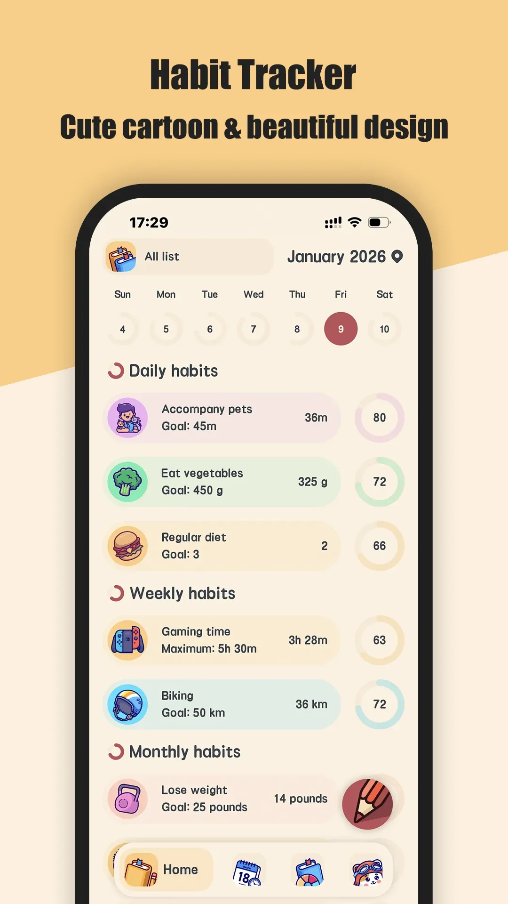{: width="180" .normal }
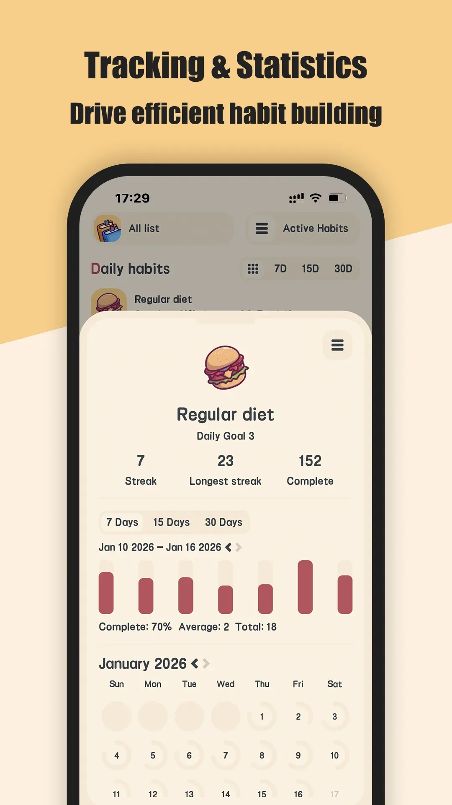{: width="180" .normal }
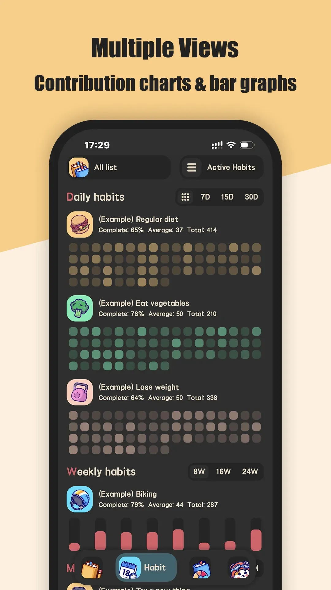{: width="180" .normal }

喵窝习惯是一款以**本机记录、无需账号**为前提的习惯打卡应用，界面围绕月历展开。它的设计取向很清楚：把「这条习惯在这个周期里完成了多少」算明白，再让你从月历、详情页、趋势页和小组件四个入口看到结果。

#### 一条记录：五种打卡动作

点击习惯会展开打卡面板，提供 `+1`、`-1`、直接输入数值、一键标记完成，以及标记跳过。一个周期只保留一条累计记录，可以附带备注；完成时有音效反馈。这意味着「每天早上喝 2 杯水、下午又喝 3 杯」不会被记成两条流水，而是当天累计到 5 杯，再和 8 杯的目标比对。

#### 目标与周期：养成、戒除与自定义单位

新建习惯时可配图标、所属清单、养成或戒掉、开始日期、频率（每日 / 每周 / 每月 / 指定星期几）、重复间隔、单位（数量、时间或自定义）、目标值、备注与通知。内置清单有健康、运动、学习、效率、省钱、快乐等方向，并提供一批预设习惯模板，适合不知道从哪开始的人。

需要注意的是，**周期、目标与开始日期在创建后不可再改**，能改的是图标、清单、备注和提醒。所以第一次建习惯时把「每周三次」还是「逢周一三五」想清楚，比事后调整更省事。

#### 连续次数与完成率：三个数字加一张热力图

详情页顶部给出当前连续、最长连续与完成次数，下方可切换最近 7 / 15 / 30 天，看逐日柱状与「完成率 / 平均 / 总计」，再往下是整月日历热力。养成型的单周期完成率按完成值与目标值之比计算并封顶 100%，戒除型按是否守住上限判定。首页月历则把当天该做的习惯以进度环显示，一眼看出哪几条还没达标。

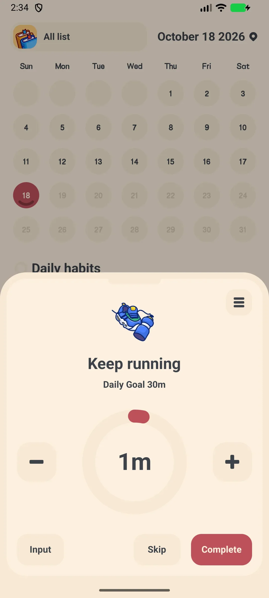{: width="180" .normal }
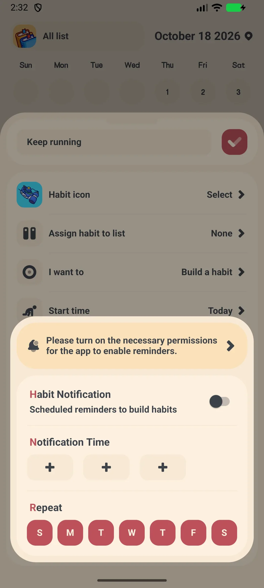{: width="180" .normal }

#### 提醒、小组件与一步打卡

每条习惯可以设多个提醒时刻并指定生效的星期；另有一天一次的汇总提醒，列出当天待完成的习惯。系统层面还提供通知权限与电池优化引导，避免提醒被系统拦下。桌面侧提供多种小组件：习惯列表、单条习惯、周 / 月 / 年统计、饼图与月热力图，其中单习惯组件可以直接在桌面完成打卡。

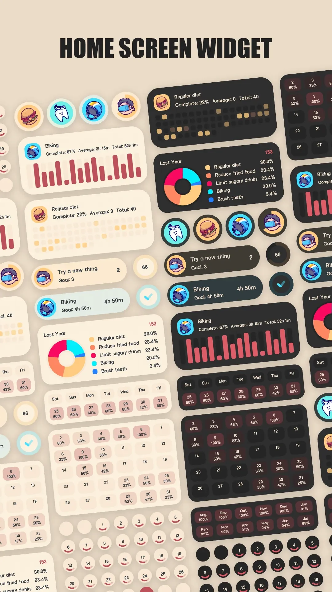{: width="180" .normal }

#### 数据：本地库、CSV 导出与可自建备份

记录保存在设备本地，不需要账号，也不提供实时多设备同步。需要迁移时，可以按时间范围、勾选部分或全部习惯导出 CSV；也可以把整库备份到 Google Drive，或填自己的 WebDAV 地址，恢复时用备份覆盖现有数据。自动备份最多每天一次。这套组合适合「不想把日常交给服务器，但又怕换手机丢数据」的人。

#### 额度与边界

免费版可创建的习惯数与清单数有上限，更多习惯以及深色主题、应用锁、CSV 导出等需要解锁会员功能。它**不做**健康数据自动同步、社交排行、AI 建议，也没有账号云同步与 CSV 导入；自定义颜色、结束日期、未来日期打卡、多层级子习惯同样不在能力范围内。想要「自动从手环读步数」或「和朋友比连续天数」，得另找工具。

| 适合 | 不适合 |
|---|---|
| 想离线、无账号地长期记录；需要数值目标与自定义单位；依赖桌面小组件一步打卡；希望数据能导出或备份到自建服务 | 需要跨设备实时同步；希望自动接入健康数据；把社交 / 排行当主要动力；习惯数量多且不愿受免费额度限制 |

除首页与详情页外，还有三类值得单独看的视图：清单与预设模板如何分组、全局成就统计，以及本地记录的隐私保护。

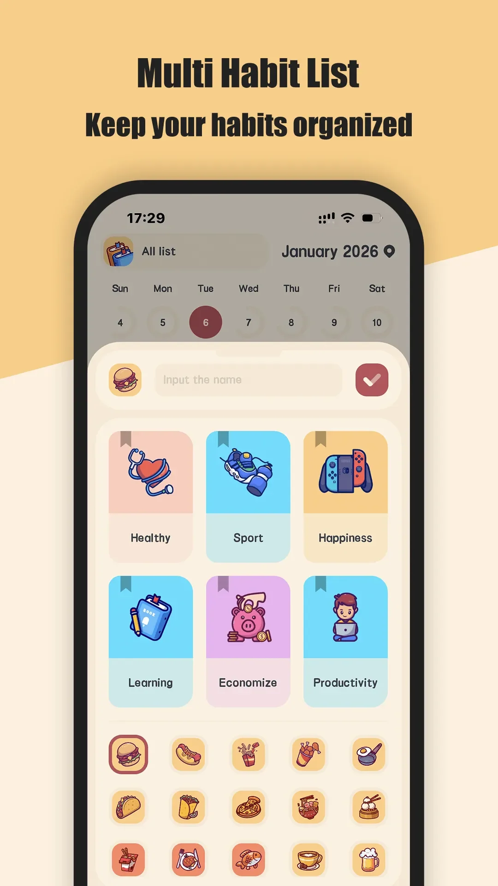{: width="180" .normal }
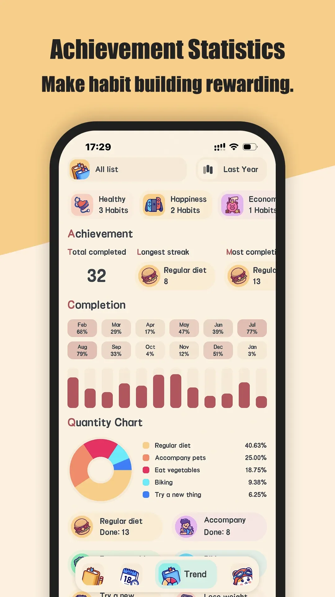{: width="180" .normal }
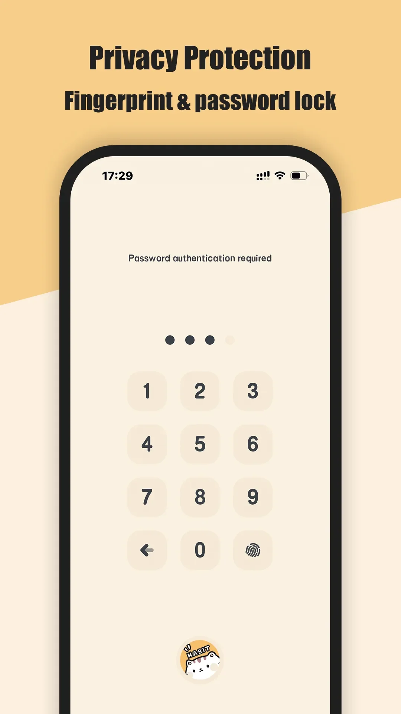{: width="180" .normal }

<!-- 说明：截图目录内暂无「导出 CSV / WebDAV 备份」设置页画面，该能力以正文文字描述 -->

### Streaks（Apple 生态）

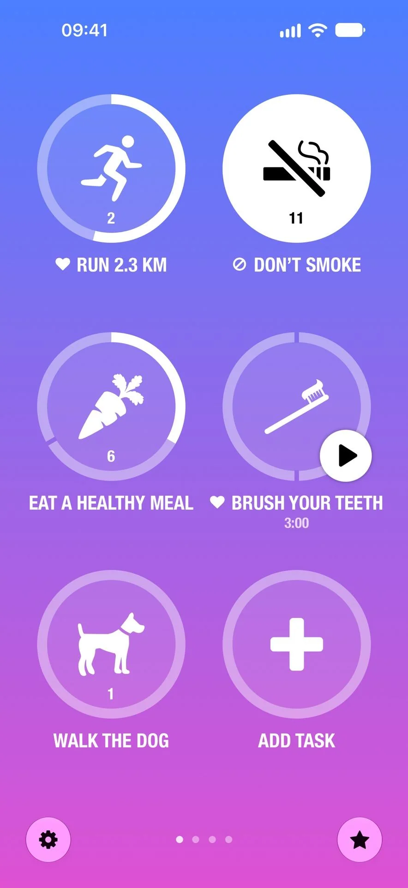{: width="180" .normal }
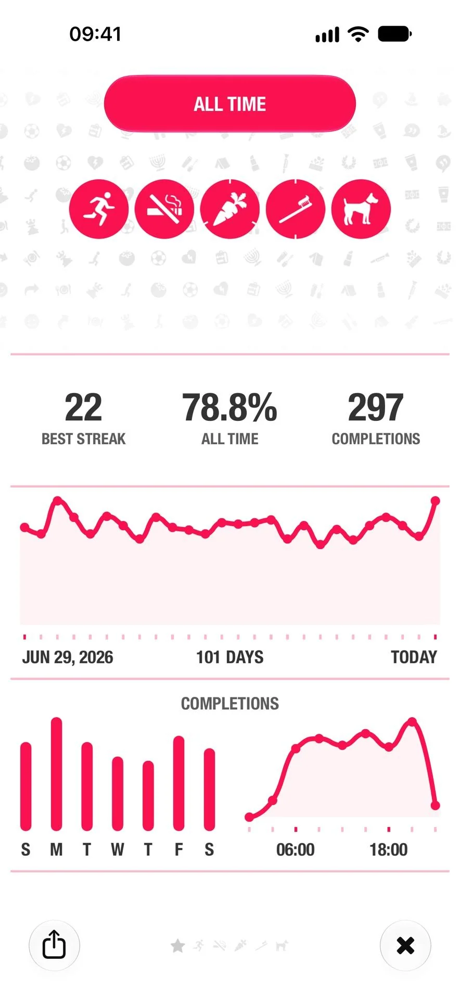{: width="180" .normal }

Streaks 把「别断链」写进了产品名字。官网当前标注**最多可建 24 个任务**（早期资料常见 12 个，属于版本差异，以应用内为准）；任务可以设成每天、指定星期几或每周若干天，也能标休息日，休息日不打断连续次数。除了一次勾选的任务，还有计时任务（如冥想 10 分钟）与「不要做」的负向任务。

它的机制重点是**周期与自动完成**：可以借助 Apple Health 把步数、正念分钟、活动圆环等数据直接转成一次完成，减少手动记录。统计侧给出当前与最佳连续、完成率、日历与趋势；界面提供大量图标与配色主题，并支持小组件、Siri 快捷指令与锁屏计时。

数据经 iCloud 在 iPhone、iPad、Apple Watch、Mac 等设备间同步，官方说明不经过自己的服务器；采用一次性买断、无订阅无广告。代价也很直接：仅覆盖 Apple 生态，安卓用户用不了；且漏掉应做的一天，连续天数就从头开始——喜欢明确规则的人会觉得干净，容易被断链打击的人会觉得紧绷。

### Habitica

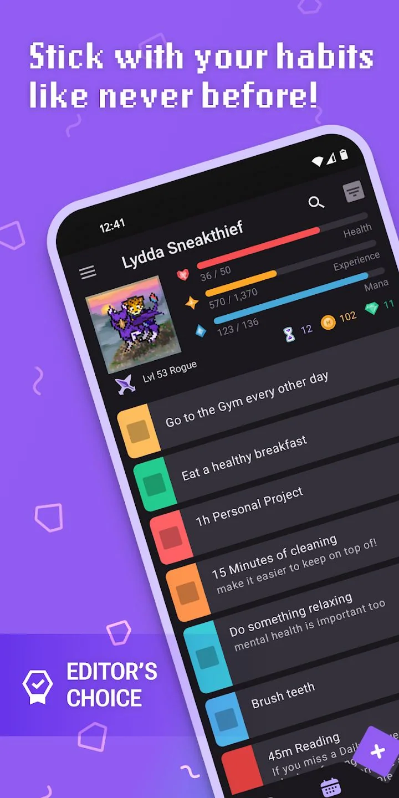{: width="180" .normal }
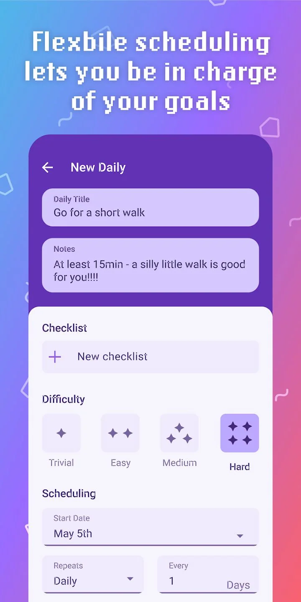{: width="180" .normal }

Habitica 干脆把习惯追踪做成了一款角色扮演游戏。它把行为分成四类：**习惯**（随时点击 `+` / `-`，可设正向、负向或双向）、**每日任务**（按日程重复，到期未完成会扣生命值）、**待办**（一次性，可设截止日，错过不扣血）与**奖励**（用金币给自己兑换）。正向习惯给经验与金币，负向习惯扣血；每日任务的重复周期可以设成每天、每周三次、每月四次，难度越高，完成奖励越丰厚。

这套设计把「断签」变成了明确的代价：生命值归零时，金币清零、角色降一级，并可能失去装备。它同时提供组队、副本、职业与属性成长，把坚持从个人记录变成协作玩法。任务、队伍与副本本身免费，付费部分主要是外观宝石与可选订阅（订阅给每月宝石、掉落加成等）；客户端开源，另有网页版，覆盖 iOS、Android 与 Web。

如果你对经验条和装备毫无兴趣，这套换算只会增加负担；但对「没有外部反馈就坚持不下去」的人，它是 7 款里唯一把奖惩做成系统的产品。

### Loop Habit Tracker

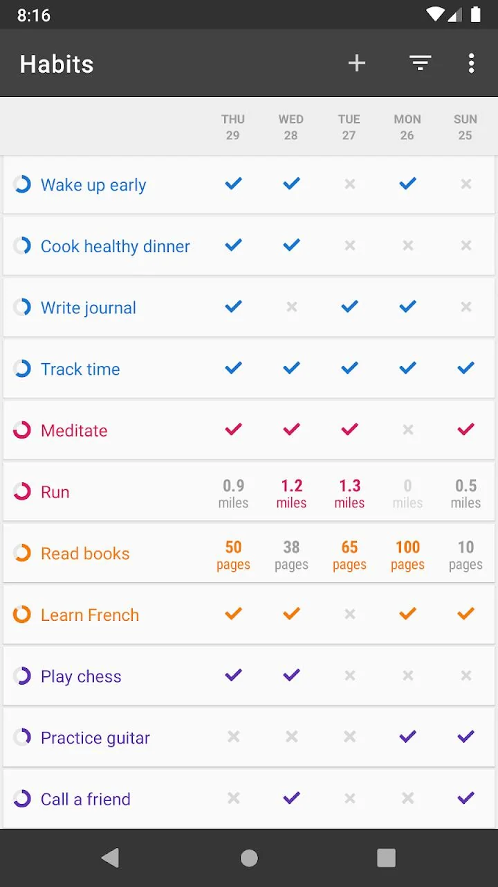{: width="180" .normal }
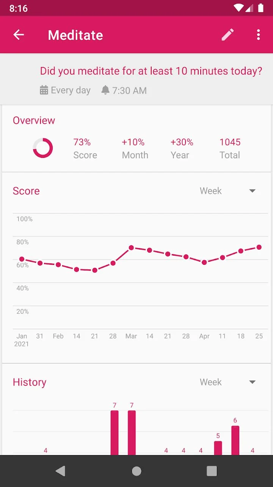{: width="180" .normal }

Loop 最值得讲的不是界面，而是它**拒绝「断链即归零」**。官方商店描述里明确写道：产品使用一个高级公式计算「习惯分数」，每次重复让习惯变强，错过则变弱；坚持很长一段时间后漏掉几天，不会把全部进度毁掉。这正好回应了前面提到的断链焦虑——长期趋势比一条不能断的链更接近习惯形成的真实曲线。

周期上，它支持每日、每周 3 次、隔周 1 次、隔天等灵活时间表；打卡矩阵里也能看到按英里、页数记录的数值型习惯。提醒可为每条习惯单独设时间，并在通知里直接完成、忽略或延迟，不必打开应用，手表上也能处理。统计侧有详细的图表与完整历史。

数据完全留在本机，不需要账号、不联网上传，可导出为 CSV 或数据库文件；应用无广告、开源。它是「纯本地 + 可携带」这一路走得最彻底的产品，但只在安卓上提供，界面也偏向工具而非激励。

### Habitify

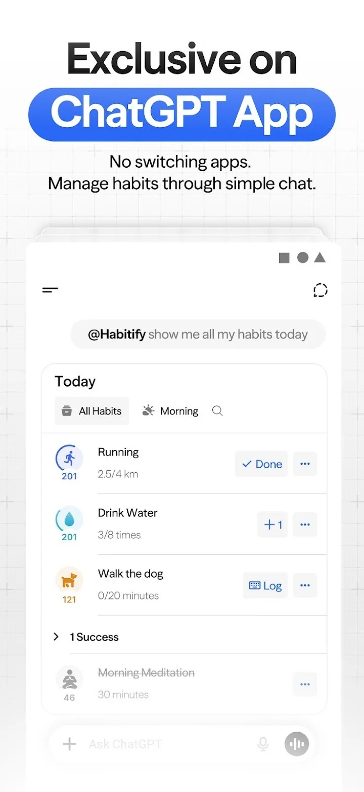{: width="180" .normal }
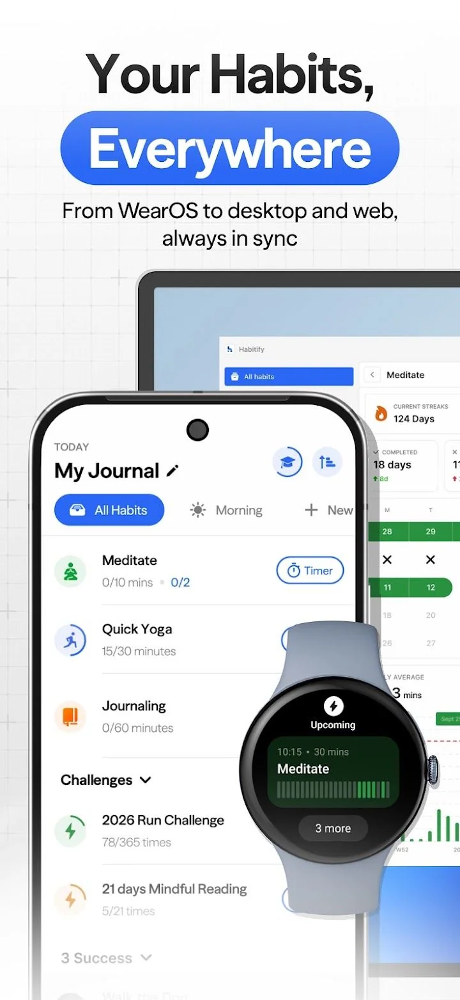{: width="180" .normal }
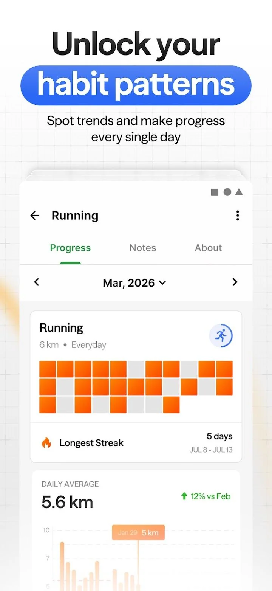{: width="180" .normal }

Habitify 的思路是**把习惯放进一天的时间轴**：早、午、晚各归一组，打开应用按当下时段看该做什么即可。官网强调跨平台覆盖 iPhone、Android、Mac、Web 与手表，并做实时同步；还提供日历集成、健康数据集成、接口与自动化连接，以及备注、心情记录、内置计时器和隐私锁。统计视图则把完成记录排成热力图，并给出累计数据。

它的定位与「纯本地工具」相反：账号、同步、多端体验是主要卖点。官方定价页标注免费版可用 3 个习惯（含跨平台同步、提醒等），无限制习惯属于付费方案；另有好友挑战与社区玩法。若你只在一台安卓手机上打卡、也不想注册，这些能力大半用不上；但如果你在手机、电脑和网页之间来回切换，它省下的是「记录散落在不同设备」的麻烦。

### Productive

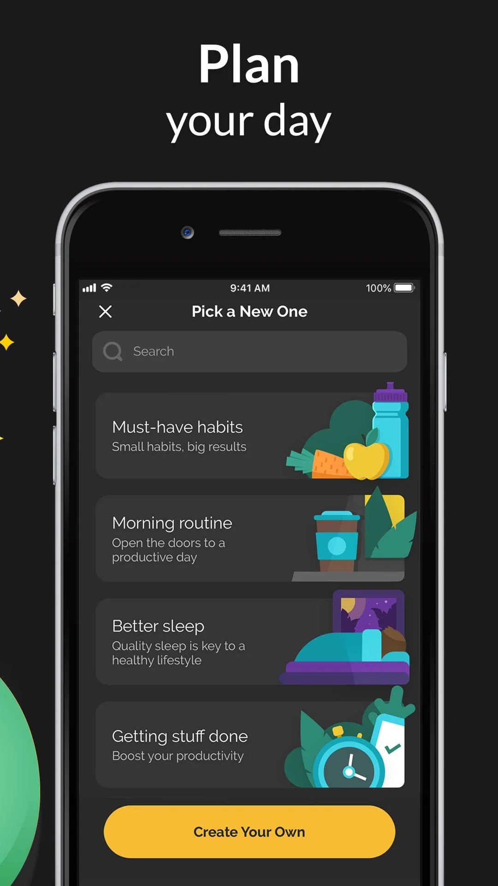{: width="180" .normal }
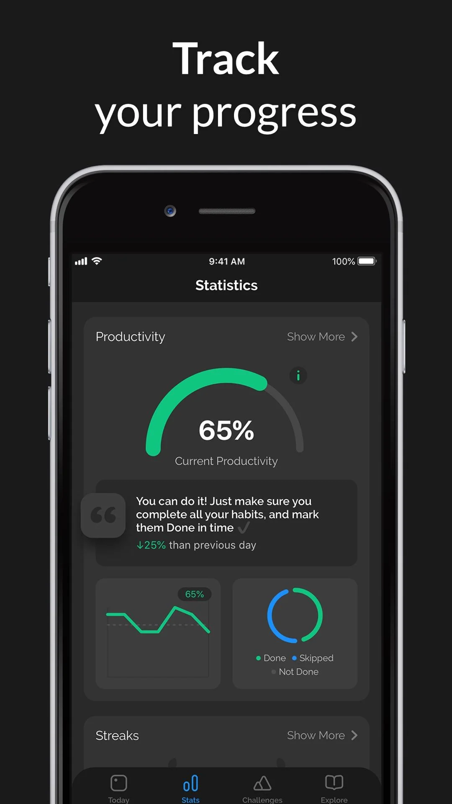{: width="180" .normal }
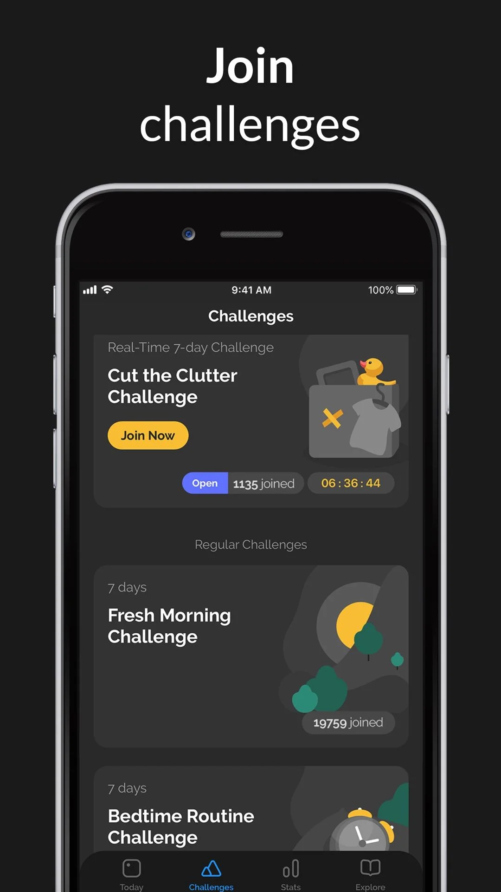{: width="180" .normal }

Productive 把习惯当作**一天的日程**来管理：从模板库挑一个习惯，放进早晨、下午或晚上，设好重复日与提醒，然后在日历里逐日勾掉。官网提到的能力包括模板库、统计与里程碑、以位置和时间为条件的智能提醒，以及可以和其他人一起参加的挑战；挑战页把限时挑战单独列成一栏，与每日计划分开。

它和 Habitify 同属「时段组织 + 账号同步」一类，但更强调计划感与轻度社交：你看到的不是一条孤立习惯，而是今天整段安排。付费上采用订阅制并提供短期免费试用，试用结束会自动转入订阅，注册时要留意。功能偏「帮我安排」，而不是「帮我把数据算清楚」，因此以完成率与里程碑为主，不深挖连续次数的口径。

### Fabulous

{: width="180" .normal }
{: width="180" .normal }
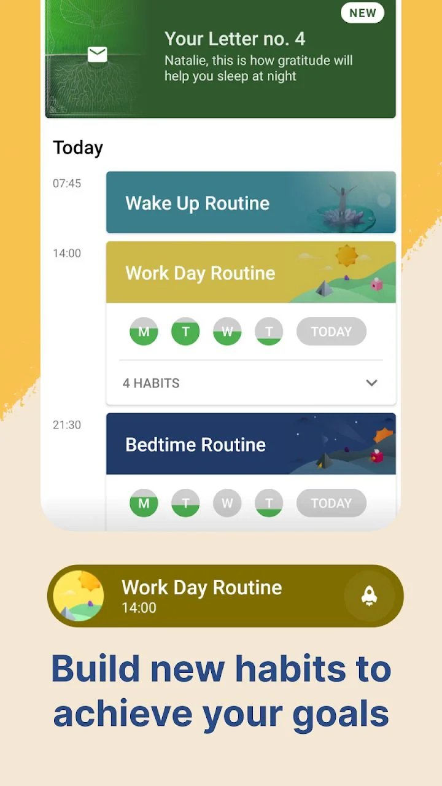{: width="180" .normal }

Fabulous 不太像打卡工具，更像一套**分阶段的行为改变课程**。它脱胎于杜克大学 Center for Advanced Hindsight 的行为经济学研究背景，主张把大目标拆成极小的行为，再用「习惯叠加」串成晨间、午后、晚间例行程序：先把「喝一杯水」稳定下来，再加下一条，而不是一次列十条待办；今日例行程序界面把当天的小步骤逐条列出，完成一项划掉一项。

产品形态围绕「旅程」推进，配套教练内容、例行程序、深度工作时段、社区与真人教练预约；统计上不突出连续天数，而以阶段完成度为主。代价是它采用订阅制内容库，免费试用后会自动转订阅，且你买的主要是方案与内容，不是一套可自由定制的记录系统。想自己定义周期、目标值和导出数据的人，会觉得约束偏多。

---

## 关键维度深度对比

### 断签与遗漏的语义

| 应用 | 漏一天 | 主动跳过 | 补记历史 | 未来日期 |
|---|---|---|---|---|
| 喵窝习惯 | 连续次数按有效周期回推 | 支持，标记后不打断 | 支持，可在月历回翻 | 不允许 |
| Streaks | 连续天数归零 | 可设休息日 | 以应用内日历为准 | 不适用 |
| Habitica | 每日任务扣生命值，归零降级 | 可暂停伤害 | 以任务历史为准 | 不适用 |
| Loop | 习惯分数衰减，不清零 | 以灵活时间表规避 | 打卡矩阵可回溯 | 不适用 |
| Habitify / Productive | 日历显示未完成 | 以重复规则规避 | 以应用内日历为准 | 不适用 |
| Fabulous | 按阶段推进，不强调连续 | 不设断链机制 | 不适用 | 不适用 |

### 周期、目标与完成判定

| 应用 | 周期表达 | 数值型目标 | 完成率口径 |
|---|---|---|---|
| 喵窝习惯 | 日 / 周 / 月 / 指定星期 / 每 N 天 | 支持，单位可自定义 | 完成值 ÷ 目标值，封顶 100%；戒除型按是否守住上限 |
| Streaks | 每天 / 指定星期 / 每周若干天 + 休息日 | 计时任务覆盖时长 | 完成天数与完成率 |
| Habitica | 每日任务可设每天 / 每周三次 / 每月四次 | 以勾选为主，数值靠自定义奖励 | 等级 / 经验 / 金币，非百分比完成率 |
| Loop | 每日 / 每周 3 次 / 隔天 / 隔周 | 支持 | 习惯分数 + 完成率 |
| Habitify | 每日 / 指定星期，按时段归组 | 以勾选为主 | 完成率与日历 |
| Productive | 重复日 + 时段 + 一天多次 | 以勾选为主 | 完成率与里程碑 |
| Fabulous | 旅程阶段 + 例行程序 | 不适用 | 阶段进度 |

### 提醒、记录入口与数据

| 应用 | 提醒 | 一步记录 | 数据位置 | 导出 / 备份 | 账号 |
|---|---|---|---|---|---|
| 喵窝习惯 | 每习惯多时刻 + 指定星期 + 每日汇总 | 桌面小组件 | 本机 | CSV 导出、Google Drive / WebDAV 备份 | 不需要 |
| Streaks | 按任务提醒 | 小组件、Siri、Apple Health 自动完成 | iCloud（Apple 生态） | 依赖生态同步 | 不需要 |
| Habitica | 每日任务提醒 | 应用内加减 | 云端 | 账号体系内 | 需要 |
| Loop | 每习惯单独提醒，通知里可完成 / 忽略 / 延迟 | 通知与小组件、手表 | 本机 | CSV / 数据库导出 | 不需要 |
| Habitify | 高级提醒、时段提醒 | 小组件、多端 | 云端实时同步 | 云端 + 日历 / 健康集成 | 需要 |
| Productive | 基于时间 / 位置的智能提醒 | 应用内勾选 | 云端 | 账号体系内 | 需要 |
| Fabulous | 例行程序提醒 | 应用内步骤勾选 | 云端 | 账号体系内 | 需要 |

### 平台与付费模式（按官方页面口径）

| 应用 | 主要平台 | 付费模式 | 明确不做的常见能力 |
|---|---|---|---|
| 喵窝习惯 | Android（商店另列 iOS 入口） | 免费版有习惯 / 清单数量上限，部分功能需解锁 | 健康数据自动同步、社交排行、账号云同步 |
| Streaks | iPhone / iPad / Apple Watch / Mac / Vision Pro | 一次性买断，无订阅无广告 | 安卓 / Windows；任务数有上限 |
| Habitica | Web / iOS / Android | 核心任务免费，外观与可选订阅付费 | 不是纯本地工具，记录需账号 |
| Loop | Android | 免费、开源、无广告 | iOS；账号同步；游戏化激励 |
| Habitify | iOS / Android / Mac / Web / Watch | 免费 3 个习惯，无限制需付费 | 纯离线使用 |
| Productive | iOS 为主，另有网页入口 | 订阅制 + 短期免费试用 | 离线无账号使用、数据自由导出 |
| Fabulous | iOS / Android | 订阅制内容库 + 免费试用 | 自定义周期口径、开放数据导出 |

---

## 你该选哪个

把六点框架套回具体场景，选择会清楚很多：

- **先问记录要不要带数量**。要记「8 杯水 / 30 分钟 / 3 公里」，喵窝习惯与 Loop 的口径最完整；只想要勾一下，Streaks、Habitify、Productive 的链路更短。
- **再问周期是否规整**。只在周一三五做，或每周凑够三次即可，重点看指定星期与灵活时间表——喵窝习惯、Streaks、Loop、Habitica 都给了明确选项。
- **然后问断一天能不能接受清零**。会被清零打击的，看 Loop 的衰减分数或喵窝习惯的跳过；想要明确规则的，Streaks 最直白；想要外部奖惩的，Habitica 最有力。
- **接着问数据放哪**。不想注册、还想自己备份，喵窝习惯与 Loop 是这一路；多设备来回切换，Habitify / Productive / Fabulous 的同步更省事；全在 Apple 生态，Streaks 借 iCloud 即可。
- **最后问你要的是工具还是方案**。想自己定义习惯、周期、图表，选记录型；想要一套有人带着走的改变流程，Fabulous 的课程型更合适。

还拿不定主意时，可以先按[习惯追踪应用总览](/zh/posts/pillar-habit-tracker-apps-android/)缩小范围，再看[喵窝习惯与 Streaks 的逐项对照](/zh/posts/vs-meow-habits-and-streaks/)。如果你更在意中文界面、离线可用和主屏小组件，[安卓习惯打卡应用](/zh/apps/meow-habits/)这一条线也值得单独看。

### 各应用官方下载

| 应用 | Android | iOS / 其它 |
|---|---|---|
| 喵窝习惯 | [Google Play](https://play.google.com/store/apps/details?id=com.glgjing.meow.habit.goal) | [App Store](https://apps.apple.com/app/id6758230559) |
| Streaks | — | [App Store](https://apps.apple.com/app/id963034692) · [官网](https://streaksapp.com/) |
| Habitica | [Google Play](https://play.google.com/store/apps/details?id=com.habitrpg.android.habitica) | [官网 / 网页版](https://habitica.com/) |
| Loop Habit Tracker | [Google Play](https://play.google.com/store/apps/details?id=org.isoron.uhabits) | [官网](https://loophabits.org/) |
| Habitify | [Google Play](https://play.google.com/store/apps/details?id=co.unstatic.habitify) | [官网](https://www.habitify.me/) |
| Productive | — | [官网](https://productiveapp.io/) |
| Fabulous | [Google Play](https://play.google.com/store/apps/details?id=co.thefabulous.app) | [官网](https://www.thefabulous.co/) |

---

## 常见问题（FAQ）

**习惯应用到底解决什么问题？**
{:.faq-q}

把模糊的意图变成可核对的记录，并降低「想起来 → 记下来」的摩擦。它不替你养成习惯，但能让行为可见、让进展有反馈、让复盘有依据。行为科学研究提示新行为自动化常常需要数周到数月（Lally 等人 2010 年估计中位数约 66 天，个体差异很大），这段过程里，记录是最容易坚持的外部线索之一。

**连续天数断了一天，是不是前功尽弃？**
{:.faq-q}

不是。Lally 等人的研究发现，漏掉一次机会并没有显著改变习惯形成的整体曲线。产品也给出了不同处理：Streaks 会清零，Loop 让习惯分数缓慢衰减，喵窝习惯允许把周期标记为「跳过」，Habitify / Productive / Fabulous 则不以连续次数为核心。选与你心态匹配的口径，比硬撑一条链更重要。

**「每周三次」和「指定周一三五」有什么区别？**
{:.faq-q}

前者一周内任意三天完成即可，适合日程不固定的人；后者只在指定日产生待办，其余日子不算遗漏。Loop 官方明确支持「每周 3 次」这类灵活时间表，Habitica 的每日任务也可设成每周三次，喵窝习惯则把频率、重复间隔和指定星期拆开配置。建习惯前先确认应用用的是哪一种。

**数值型目标和简单打卡，该选哪个？**
{:.faq-q}

看行为本身有没有「程度」。喝水、阅读、跑步适合数值型：能看出今天是完成 60% 还是 100%，复盘信息多很多；早睡、不喝含糖饮料更适合勾选。喵窝习惯与 Loop 都支持带单位的数值目标，喵窝习惯在打卡面板里同时提供加减、输入、一键完成与跳过。

**跳过和漏记是同一件事吗？**
{:.faq-q}

不是。漏记是「该做但没记」，通常会影响连续次数；跳过是主动声明「这个周期本来就不做」，既不打断连续次数，也不计入完成。把出差、生病这类日子提前或事后标成跳过，日历才不会把客观休息误判成失败。

**不注册账号能用吗？换手机怎么办？**
{:.faq-q}

喵窝习惯与 Loop 都不需要账号，数据存在本机；Streaks 借 iCloud 在 Apple 设备间同步，也不需要向厂商注册。换设备前记得导出或备份：喵窝习惯可按时间范围导出 CSV，或整库备份到 Google Drive / 自建 WebDAV；Loop 可导出 CSV 或数据库文件。Habitify、Productive、Fabulous 与 Habitica 走账号同步，换设备更省事，但记录会经过服务端。

**习惯应用会自动同步手环或健康数据吗？**
{:.faq-q}

取决于产品。Streaks 可借 Apple Health 把步数、正念分钟等自动标记为完成；Habitify 提供日历与健康数据集成。喵窝习惯**不提供**健康数据自动同步，打卡以手动为主——这也是它能保持纯本地、无账号的前提。看到「自动记录」的宣传时，先确认具体接的是哪个平台。

**免费版一般限制什么？**
{:.faq-q}

常见是习惯数量或功能层级。Habitify 官方标注免费版 3 个习惯；喵窝习惯的免费版对习惯数与清单数设上限，深色主题、应用锁、CSV 导出等属于解锁项；Loop 免费且开源无广告；Streaks 一次性买断；Productive 与 Fabulous 采用订阅制加短期试用。订阅制产品的试用结束会自动转订阅，注册前留意取消时间。

---

## 相关术语

- [什么是习惯追踪器（Habit Tracker）？](/zh/glossary/what-is-a-habit-tracker/)
- [什么是连续天数（Habit Streak）？](/zh/glossary/what-is-a-habit-streak/)
