周三下午三点，你忽然想起「下周三要交季度报表」。把它写在一张便签上，和把它记进清单应用，区别并不在屏幕是不是更漂亮，而在这条信息之后会怎样：到了下周三，它会不会自己出现在你眼前；漏掉那天，它是被标出来还是悄悄沉下去；做完之后，它是留下一道痕迹，还是变成又一个待清理的条目。

把同一句话交给 7 款清单应用，会得到 7 种答案。有的把它拆成标题、日期、优先级三个字段，有的只留一行字；有的完成一次就自动派生出下个月的那一次，有的替你把今天重新排一遍；有的数据落在本机、换手机要自己备份，有的必须注册账号才能开始用。功能列表看起来大同小异，真正决定体验的，是这些「之后会怎样」。

所以这篇不比谁的勾选项更长。我们跟着一条任务走完五段路——记下来、放好、当天做、打勾、回头看——顺带把两个更基础的问题说清楚：**清单应用到底是什么**，以及**它究竟替人解决了什么**。想直接比较选型，可以看 [安卓清单与任务管理应用全景](/zh/posts/pillar-todo-list-task-manager-apps-android/) 和 [喵窝清单与 Todoist 的差异](/zh/posts/vs-meow-todo-and-todoist/)。

> 核对口径：竞品的功能、配额与价格来自各家官方页面、官方帮助中心与应用商店描述，核对时间为 2026 年 11 月；自家产品的规则以应用内可见的设置项与行为为准。版本更新较快，涉及付费与额度的数字请以当下页面为准。本文只讨论面向个人使用的任务清单，不展开团队项目管理。

## 一、清单应用替你保管的，是「还没有做完」这件事

### 一张便签和一套系统，差在三层

纸上的待办是一句话；清单应用里的待办是一条**有去处的记录**。把它拆开，几乎所有产品都由三层组成：

- **条目**：一条任务携带的字段。最少只需要一个标题，多则可以带备注、计划时间、优先级、重复规则、标签、清单、子任务和完成状态。
- **容器**：条目放在哪里。清单、文件夹、项目、区域、标签，本质都是给条目一个归属，好让你按某个维度把它们捞出来。
- **视图**：同一批条目按什么口径重新排列。今天、明天、未来 7 天、即将到期、已完成、日历、看板，都不是另一份数据，而是同一份数据的不同切面。

这三层解释了清单应用为什么不是「电子便签」：它多做的那一步，是给每一条未完成的事安排一个**什么时候会再被看见**的规则。你不必记住它，只需要在合适的时候被它找到。

### 它和日历、习惯应用、笔记各管一段

新手最容易混淆的，是把所有「要记的东西」都塞进同一个工具。其实四类工具的分工很清楚：

| 工具 | 记录的基本单位 | 时间语义 | 典型问题 |
|---|---|---|---|
| 清单应用 | 一条任务（做完即结束） | 某天或某个截止点之前完成 | 有哪些事还没做完 |
| 日历 | 一段时间块 | 有明确起止时刻，占用时间 | 周三下午三点我在做什么 |
| 习惯应用 | 一个周期里的一次完成 | 按周期反复出现，没有终点 | 这周的运动做了几次 |
| 笔记 / 文档 | 一段可长期修改的内容 | 通常没有完成状态 | 这份资料放在哪里 |

一个常见的实际搭配是：任务写在清单里，真要占用两小时的那些再落到日历上，需要长期反复养成的习惯交给习惯应用，参考资料留在笔记里。清单应用的独特之处，是它**为「完成」这个动作留了一个明确位置**——这是笔记和日历都不提供的。

### 核心概念小词典

下面这些词在后面的对照里会反复出现，先在这里把口径定下来：

- **收件箱（Inbox）**：先记下、暂不分类的暂存区。价值在于把「想到」和「想清楚放哪」拆成两步，避免为了归类而干脆不记。
- **子任务（Subtask）**：把一条任务拆成可逐项勾选的步骤。多数产品只支持一层，且子任务本身不带独立日期；详见 [什么是子任务](/zh/glossary/what-is-a-subtask/)。
- **清单 / 标签 / 项目**：清单通常是「归属」（一条任务只进一个），标签通常是「维度」（一条任务可贴多个），项目则往往带目标与阶段。三者能否叠层，决定了组织能力的上限。
- **重复规则（Recurring rule）**：让一条任务按日、周、月、年或自定义间隔再次出现，可设结束日期或结束次数。关键差别在于「完成当前这条之后，下一条怎么生成」。
- **今天视图（Today view）**：从全部任务里挑出今天要面对的那几条。它不是简单筛选当天日期的任务，不同产品对逾期的处理各不相同。
- **逾期（Overdue）**：过了计划时间仍未完成。有的产品自动顺延到今天，有的标红并一直留在「已过期」，有的把逾期任务并入今天视图。
- **自然语言输入（Natural language input）**：在标题里直接写「下周三 15:00 交报表」，由应用解析出日期与提醒。它缩短的是第一段路的入口成本。
- **归档 / 完成态**：打勾之后条目去哪。有的进入可检索的历史，有的折叠成一条计数，有的直接从列表消失。

概念看起来琐碎，但真正让两款应用「手感不同」的，几乎全是这些词背后的规则。

## 二、跟着一条任务走完五段路

### 第一段 · 捕获：一句话被拆成几个字段

输入成本决定了一个清单会不会被真正用起来。最轻的做法是只给一个标题框，日期、优先级、重复、标签都留到以后再补；最省事的做法是把这些字段塞进一句话里，由应用解析。

Todoist 和 TickTick 都把自然语言快速添加当作核心入口，官方页面也把它列进免费版能力：写「每周五 15:00 交周报」就能直接得到日期与重复规则。Google Tasks 更进一步，允许你在 Gmail 的邮件旁边、Google 日历的侧边栏里直接把一件事转成任务，连应用都不用切过去。喵窝清单走的是另一条路：标题是纯文本，日期、优先级、标签、重复分别由独立面板选择，代价是多点几下，好处是**没有解析歧义**，写什么就存什么。

这一段还有一个容易被忽略的细节：提醒是不是独立字段。喵窝清单里没有「提前 10 分钟提醒」这一项，提醒时刻等同于任务的计划时间，另有每日汇总提醒；而 Todoist 的自定义提醒属于付费档位。想要「到期前先提醒一次」的人，选之前最好确认这一点。

还有一个前置问题：想记、却还没想好归到哪，怎么办。Things 3 有独立的收件箱，TickTick 把收件箱放在侧边栏首位，Google Tasks 干脆让入口长在邮件和日历旁边；喵窝清单没有专门的收件箱，由「默认」清单和「无日期」分组承接这类条目。有没有这一步，决定了你是「先记下再整理」，还是「当场必须决定分类」——后者常常让人干脆不记。

### 第二段 · 组织：清单、标签、子任务与优先级

任务一多，问题就从「记不记得」变成「找不找得到」。这里最实质的分野是**能不能叠层**。

Things 3 用「区域 → 项目 → 标题 → 待办」搭出一套长期结构，适合把工作、家庭、个人目标长期分区；Todoist 用项目 + 层级子任务 + 标签 + 过滤器；Microsoft To Do 和 Google Tasks 更克制，主要靠多个平铺列表；喵窝清单是**一层清单 + 一层标签 + 一层子任务**，清单与标签都没有父级，子任务也不再嵌套。后者换来的是简单：新建一条任务时不用先回答「这该归到哪个文件夹」，代价是复杂项目很难拆得干净。

排序与筛选同样属于这一段。喵窝清单提供按日期、优先级、清单或「无」四种排序，非日期模式下可拖拽手动排序；搜索和导出都能按清单、标签、优先级与日期区间组合筛选。它的免费档位限制的是清单数（10 个）、标签数（10 个）和单条任务的子任务数（10 个），**并不限制任务总数**——这个口径和「免费版只能建 9 个清单、每清单 99 条任务」的 TickTick 完全不同，比较额度时值得看清限制落在谁身上。

优先级也是这一段的一部分，但各家口径不同：喵窝清单是「无 / 低 / 中 / 高」四档，TickTick 提供四象限矩阵，Google Tasks 则没有优先级。四档适合快速排序，四象限适合做取舍；没有优先级，就意味着只能靠「放进哪个列表」和「排在哪一位」来表达轻重。排序规则同理——按日期、按优先级、按清单，或者完全手动拖拽，其实是四种不同的组织思路。

### 第三段 · 执行：今天视图与逾期的语义

到了当天，产品才开始显出性格。

「今天」到底包含什么？喵窝清单的答案是：今天到期的任务，加上**所有已过期但还没完成的**任务，统一归到「已过期」分组并标出；逾期不会被自动顺延，也不会自动完成。按日期排序时，全部任务会被分成已过期、今天、明天、7 天、稍后、无日期六组。Microsoft To Do 的「我的一天」则是另一种思路：它每天都从空白开始，由你或「建议」把当天要做的重新挑进来，今天没做完的留到明天再被建议一次。前者是台账，后者是每天重排的一份清单，没有优劣，只看你更怕漏掉还是更怕被旧账压住。

重复任务是这一段最容易被忽略、却最能暴露设计假设的地方。以「每月 1 号交房租」为例，喵窝清单的做法是：勾选完成当前这条时，系统生成一条**全新的下一条**，把标题、备注、清单、标签、优先级、重复规则连同子任务一起复制过去，子任务重置为未完成，计划时间跳到下一个有效周期；中间已经过去、没来得及处理的周期会被跳过，直接落在当天或未来；如果设了按日期或按次数结束，到点就不再生成。原来那条则变成已完成、不再重复。也就是说，历史是「一条条真实完成过的记录」，而不是同一条任务被反复改写。Google Tasks 官方帮助说明重复任务可以设定在特定日期重复，但子任务只有一层、且子任务本身没有独立日期；两者的历史语义并不一样。

提醒与入口也归这一段。喵窝清单把提醒分成两类：任务到期时的通知，以及每天固定时间、可选择是否包含逾期任务的汇总提醒；桌面小组件另有快速添加、任务列表、日历与统计等形态。但它的通知点击后是打开应用首页，**没有**「完成」「稍后」这类通知内动作，小组件条目也是打开详情。把完成动作直接放进通知的产品能把摩擦再压低一层，代价是通知栏更吵。

### 第四段 · 完成：打勾之后数据去哪

这个动作太轻，轻到很少有人追问结果，但它决定了半年后你还能不能回答「那件事到底哪天做完的」。

喵窝清单把已完成任务移进「已完成」分组，首页可开关是否显示，默认只列最近 10 条，并有「显示更多」；完成时会记录完成时间，还可以播放一声提示音。它**没有回收站，也没有归档区**：删除是永久删除，「清除已完成」会明确提示无法恢复。Things 3 则有名为 Logbook 的完成记录，Todoist 把活动历史做成可检索的效率可视化（免费版保留 1 周，付费版才是完整历史）。

对需要留痕、复盘或向别人证明「做过」的人来说，这一段的差别比界面配色重要得多；对只想每天清空一次列表的人来说，反而越简单越好。

一个容易踩的坑是「清除已完成」。它让列表立刻变干净，但在没有归档区、没有回收站的产品里，这一步等于把留痕一起清掉，界面也会明确提示无法恢复。需要按季度复盘的人，最好先导出再清理；只把清单当临时看板的人，反而应该定期清，免得已完成任务把首页挤满。

### 第五段 · 回顾：日历、统计与数据出口

最后一段决定这套系统能不能长期用下去。

喵窝清单提供任务、日历、统计、设置四个主视图，日历支持日 / 周 / 月；统计可以按日、周、月、年、自定义区间或全部时间查看，包含年度贡献图、月 / 周 / 年日历热力、按清单与按标签的饼图及排行，以及按小时、周、日期分组的任务列表。桌面侧还有 10 类小组件：快速添加、任务簿、任务列表、饼图统计、月 / 周日历、周 / 月 / 年统计，其中不少可以直接在主屏幕上看到当天概况。它没有成就徽章或连续打卡体系，统计只回答「做了多少、分布在哪」，不额外制造一个需要维护的分数。

数据出口更值得单独看一眼。喵窝清单把数据留在本机，**不需要注册账号**，也没有多设备实时同步；换设备靠整库备份与恢复，支持 Google Drive 或自己填写的 WebDAV 地址，并可设置自动备份。按清单、标签、优先级、日期区间筛选后导出 CSV 是会员功能，导出的列包括清单、标题、描述、标签、日期和完成状态；**没有对应的导入功能**。这意味着它适合「不把日常记录交给服务器、但要求随时能拿走」的人，不适合「手机上记一条、电脑上立刻看到」的人。

## 三、清单应用到底有什么用

### 把「记着」外包出去

二十世纪二十年代，Bluma Zeigarnik 注意到，服务生对未结账订单的记忆比对已结账订单更鲜活，后来被概括为「未完成事项更容易停留在脑中」的蔡格尼克效应。更贴近清单应用的是 Masicampo 与 Baumeister 2011 年发表于 *Journal of Personality and Social Psychology*（101(4), 667–683, doi:10.1037/a0024192）的实验：让未完成目标持续侵入思绪的，往往不是「没做完」本身，而是**没有为它定下一个具体计划**；只要写出何时、何地、怎么做，干扰就会明显下降。

这个结论对理解清单应用很关键：它的价值不只在「帮你完成任务」，更在**把一件事从脑子里搬到一个有明确下一步的地方**。写下来 + 安排好，本身就已经卸掉了一部分负担。也别忘了证据边界——这些是实验室情境下的短期任务研究，不等于「装了清单应用就一定更高效」；真正决定结果的仍是任务本身能不能被执行。

把这条结论翻译成日常操作，就是**别只写名词，写下一步动作**。「准备季度汇报」几乎不提供可执行信息；「周三 9:00 在工位拉出上月数据」同时给出了时间、地点和第一个动作。这类「如果遇到 X，就做 Y」的写法在行为科学里被称为执行意图（implementation intentions），清单应用的价值之一，正是给这种写法提供一个固定落点。

### 四个能落到日常的价值

- **外部记忆**：把「别忘记」交给系统，脑子留给判断。尤其对那些没有固定触发点的事（报销、回邮件、缴费），便签和记忆力都不可靠。
- **把模糊变成可执行**：「准备季度汇报」是一条让人拖延的条目，拆成「拉数据」「约会议室」「写提纲」之后，启动成本立刻下降。子任务与重复规则承担的就是这一步。
- **缩短从想到到记下的距离**：小组件、通知、侧边栏、快速添加，争的都是同一件事——在念头出现的那一秒就能落笔，而不是等晚上统一补记。
- **留下可复盘的痕迹**：完成时间、贡献图、按清单分布，让「这一个月到底忙在哪」变成可查的事实，而不是印象。

### 清单是载体，不是方法论

GTD、每周回顾、四象限、时间块，这些都是方法，不是某个应用的功能。工具能提供的只有三件事：让条目有地方放、让它在合适的时候重新出现、让完成留下记录。方法没想清楚时，换应用不会解决问题；反过来，一个足够简单、你愿意每天打开的工具，往往比功能齐全但三天就懒得维护的系统更有效。

### 什么时候清单反而添乱

同一套机制也会反噬。清单不断膨胀却从不清理，会变成一份只制造焦虑的负债；每天花二十分钟重排优先级，本身就在消耗本该用来做事的时间；把「整理清单」当成「推进工作」，是最常见的自我欺骗。此外，需要多人协作、需要跨设备实时同步、或者任务本身高度依赖外部条件（等别人回复才能推进）的场景，纯本地的个人清单并不合适——它没打算解决这些问题。

一句话：清单应用负责的是**让未完成的事有去处**，不是替你把事做完。

## 四、7 款产品，各把力气花在哪一段

### 喵窝清单（Android / iOS）：把五段都留在本地

喵窝清单在 Android 与 iOS 上都有版本，两端都走「不需要账号、数据留在本机」的路线；下面的功能细则以 Android 版界面为准，iOS 版请以应用内实际显示为准。它是这 7 款里最彻底走「本地优先」的一个：不需要账号，任务、清单、标签都保存在设备上；组织上一层清单、一层标签、一层子任务；视图覆盖任务、日历、统计与设置；提醒分任务提醒与每日汇总两类；桌面有 10 类小组件。它的取舍很一致——把输入、组织、回顾都做成本地能力，代价是不做实时多端同步。

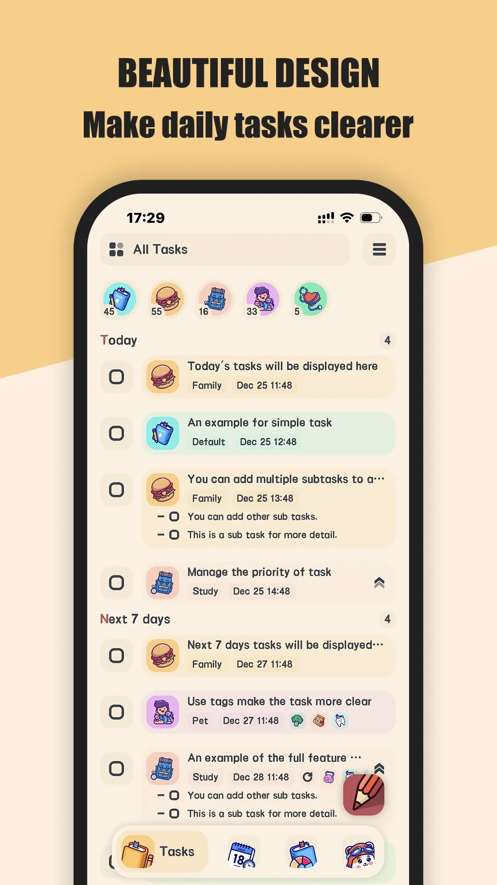{: width="180" .normal }
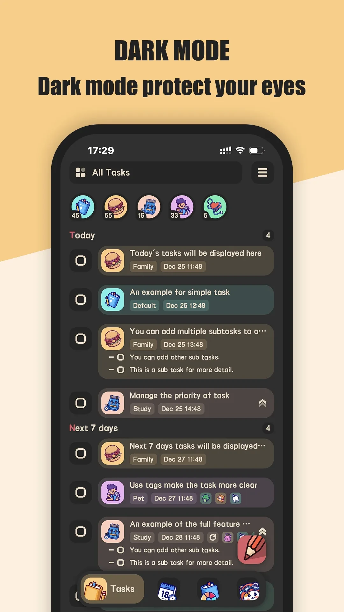{: width="180" .normal }
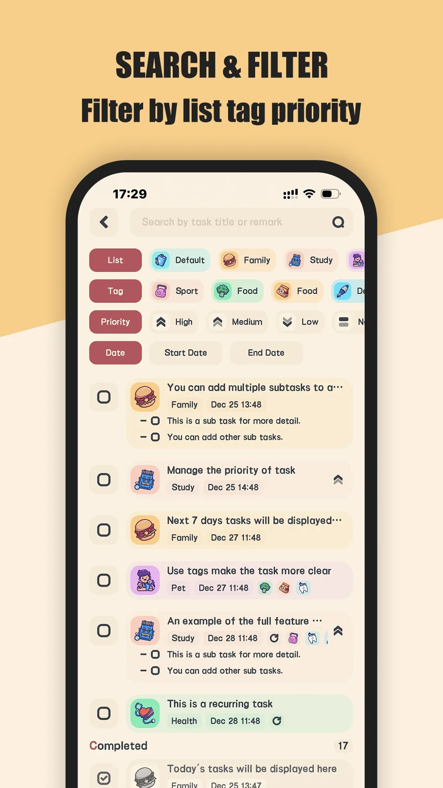{: width="180" .normal }

重复任务的处理是它最值得单独说的一点：完成当前条会派生出全新的下一条，子任务一并复制并重置，跳过的周期不会被补成一串没做的记录，可设按日期或按次数结束。逾期任务不会自动顺延，而是明确归入「已过期」并被今天视图带出来。完成后进入「已完成」分组并记录时间，但没有回收站、没有撤销删除，也没有导入。

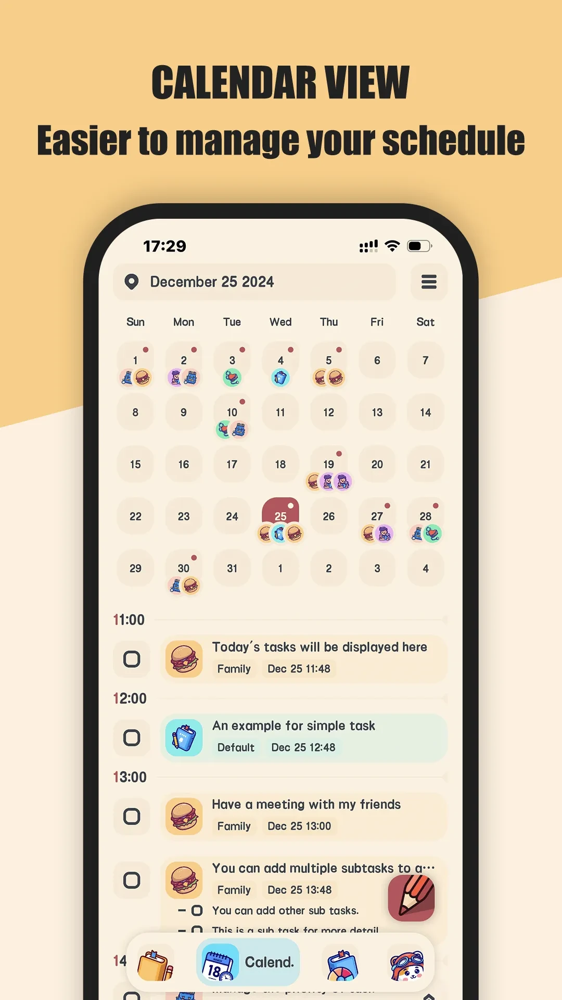{: width="180" .normal }
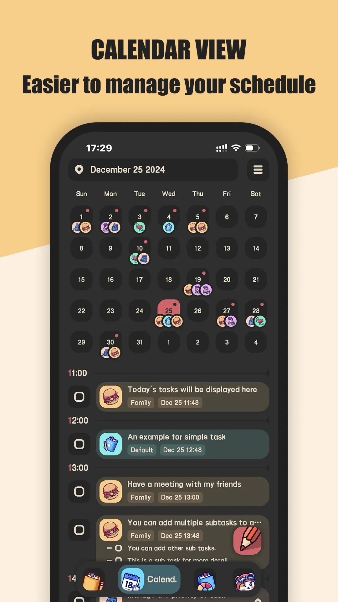{: width="180" .normal }
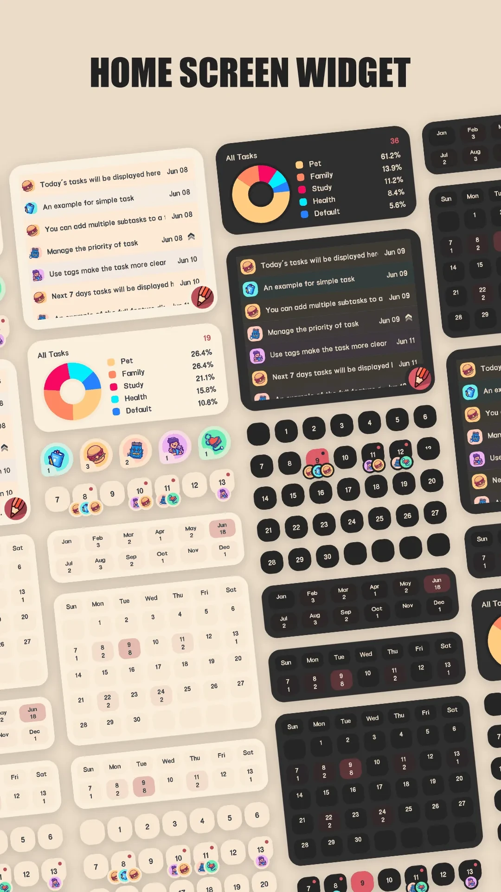{: width="180" .normal }

免费档位同时最多 10 个清单、10 个标签，单条任务最多 10 个子任务，任务总数不限；深色主题、应用锁、无限清单 / 标签 / 子任务以及 CSV 导出属于解锁项，非会员列表里会有广告。它没有自然语言解析、没有协作与指派、没有通知内一键完成、没有成就徽章，也没有独立的提醒提前量。这些「不做」和它「纯本地」的定位是一体的：想清楚边界，比多几个开关更容易判断合不合适。

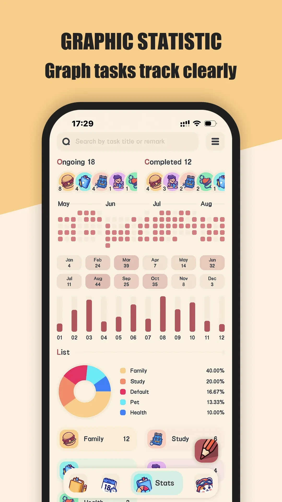{: width="180" .normal }
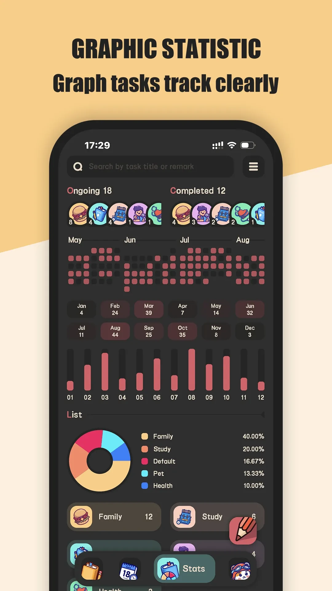{: width="180" .normal }
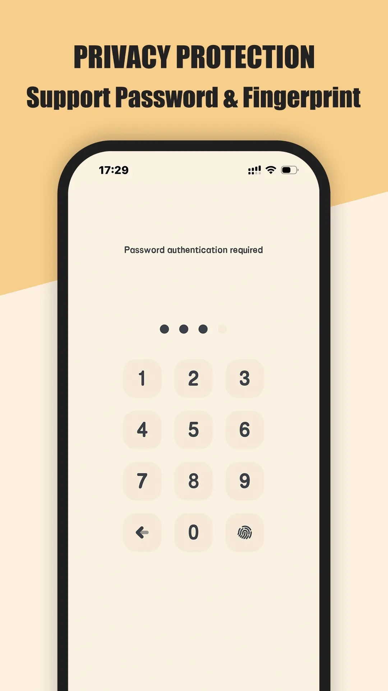{: width="180" .normal }

### Todoist：把第一段路做到最短

Todoist 的核心竞争力在捕获：智能快速添加把日期、优先级、项目、标签压进一句话，官方定价页把「智能快速添加」直接列进免费版。组织上用项目 + 子任务 + 标签 + 过滤器，视图有列表、看板，日历布局与表格布局则属于付费档位。

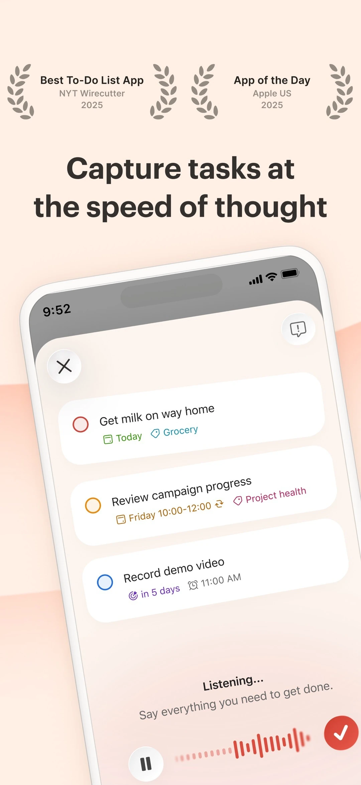{: width="180" .normal }
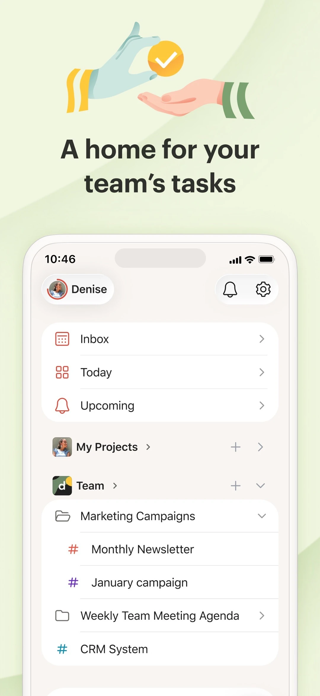{: width="180" .normal }
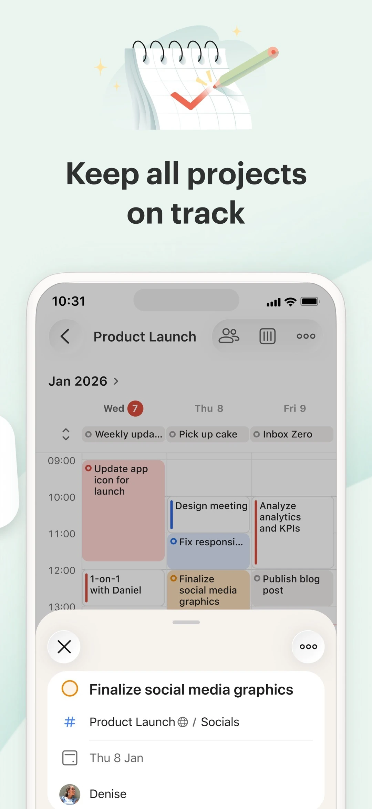{: width="180" .normal }

官方定价页的口径很明确：免费「入门」版 5 个私人项目、3 个过滤器视图、1 周活动日志，含任务提醒、循环到期日期与标签，但**不含**日历布局、自定义提醒、任务时长与自动备份；专业版按年付 US$5/月（US$60/年）或月付 US$7/月，开放 300 个私人项目、150 个过滤器与完整历史。协作、分配任务、评论在免费版也可用，每个私人项目最多 5 人。换句话说，它把「随手记」和「跨端协作」做得很轻，把「回顾与高级视图」放在付费侧。

### TickTick：把执行铺成日历、习惯与专注

TickTick（滴答清单）把清单之外的一整套执行工具都收进同一个应用：日历视图、看板、优先级矩阵、番茄钟、习惯追踪、倒数日与小组件，官方商店截图几乎就是一份功能清单。

{: width="180" .normal }
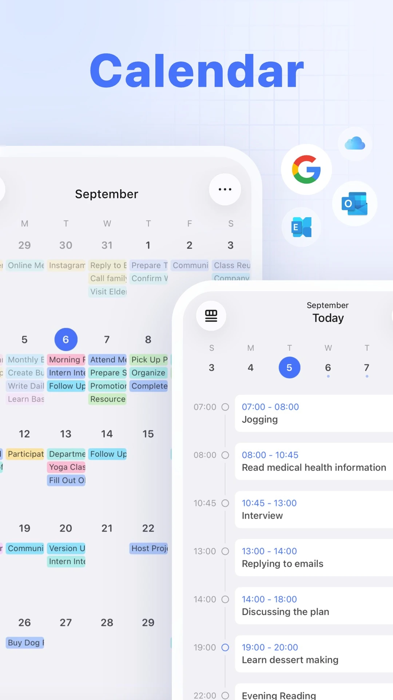{: width="180" .normal }
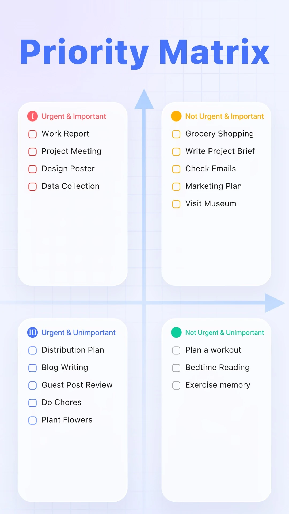{: width="180" .normal }

它的免费额度落在「清单数量」上：官方升级页写明免费版含 9 个清单、每清单 99 条任务、列表与看板视图、自然语言任务提醒、跨平台同步；Premium 为 US$49.99/年，提升到 299 个清单、每清单 999 条任务，并开放多日历视图、任务时长、邮件提醒与主题。如果你要的已经不只是「记下来」，而是把安排、专注、习惯都放在一个入口，它是这一组里覆盖最宽的；反过来，只想要一份安静的清单，这些模块就是多余的界面。

### Microsoft To Do：「我的一天」是一种每天重排

微软待办把重心放在第三段路。官方说明里，「我的一天」是一份每天从空白开始、由「建议」把任务重新挑进来的个性化清单；今天没做完的会留到明天再被建议一次。它还与 Outlook 打通：标记的邮件可以转成任务，任务数据在 Exchange 上同步，任务可拆成步骤、加备注、附加最高 25 MB 文件、设一次性或重复的到期提醒。

{: width="180" .normal }
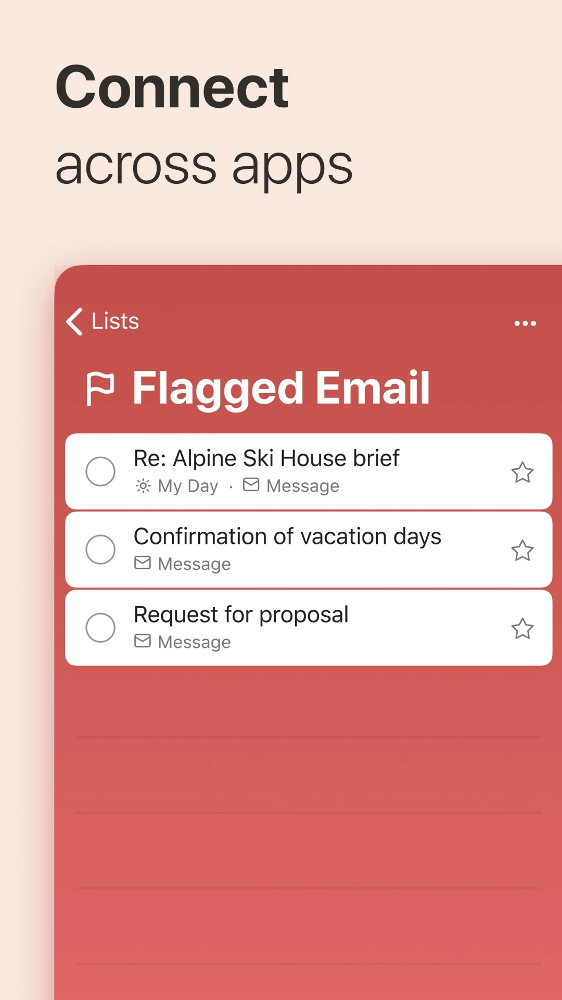{: width="180" .normal }

它在 iPhone、Android、Windows 与 Web 之间免费同步，没有单独的付费档位，也没有复杂的层级结构。适合已经把邮箱当工作台的人；代价是组织能力较浅，长期项目与复杂筛选并不顺手。

### Things 3：用区域与项目把第二段做成结构

Things 3 是这一组里唯一把「组织结构」当主角的。区域（Areas）承载长期责任领域，项目（Projects）承载有终点的目标，项目内部还能用标题（Headings）分组；Today、Upcoming、Anytime、Someday 与 Logbook 构成一套明确的视图语义，快速添加时可以直接写备注、子任务与提醒。

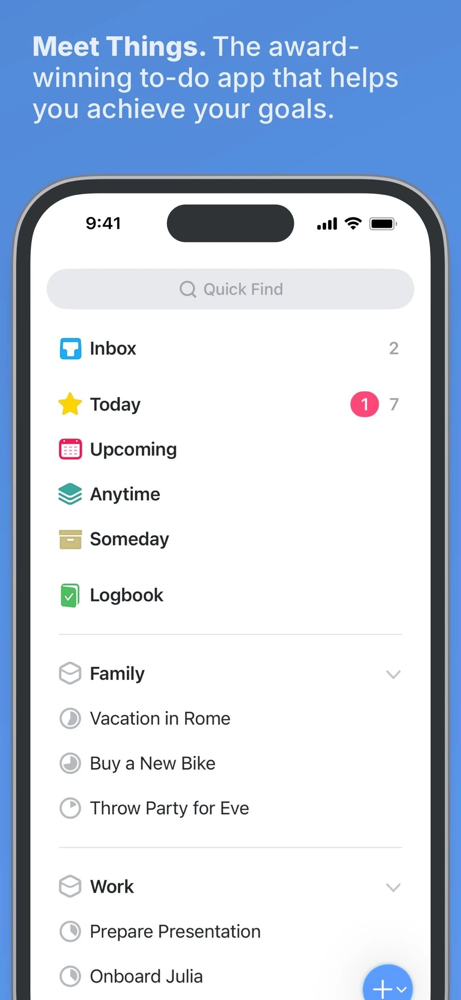{: width="180" .normal }
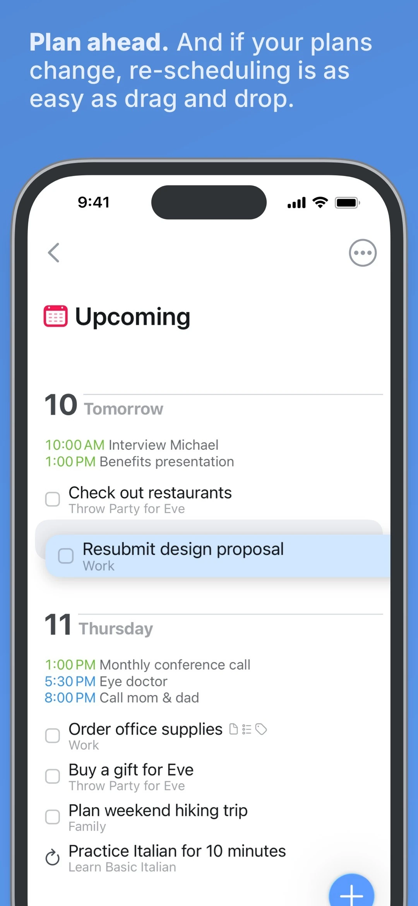{: width="180" .normal }
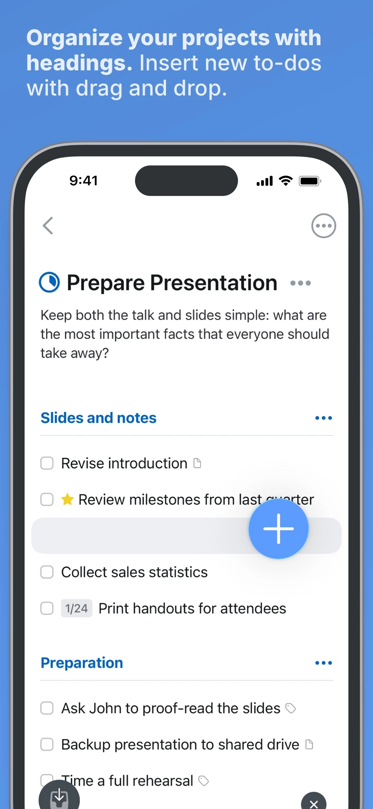{: width="180" .normal }

它按平台一次性买断、不订阅（iPhone / Apple Watch US$9.99、iPad US$19.99、Mac US$49.99，价格以官方页面为准），自家设备间的 Things Cloud 同步随购买提供，无需另付订阅。限制也非常清楚：仅 Apple 生态，没有 Android / Windows，也没有网页版；同时不做多人协作。喜欢它的人多半是被这套「长期结构」留住的。

### Google Tasks：嵌在你已经在用的地方

Google Tasks 几乎把所有成本都压在入口上。官方说明里，任务可以在 Gmail、Google 日历、Chat 与 Docs 的侧边栏直接创建，加日期与时间后会自动出现在日历上，也支持截止期限、按特定日期重复与子任务。

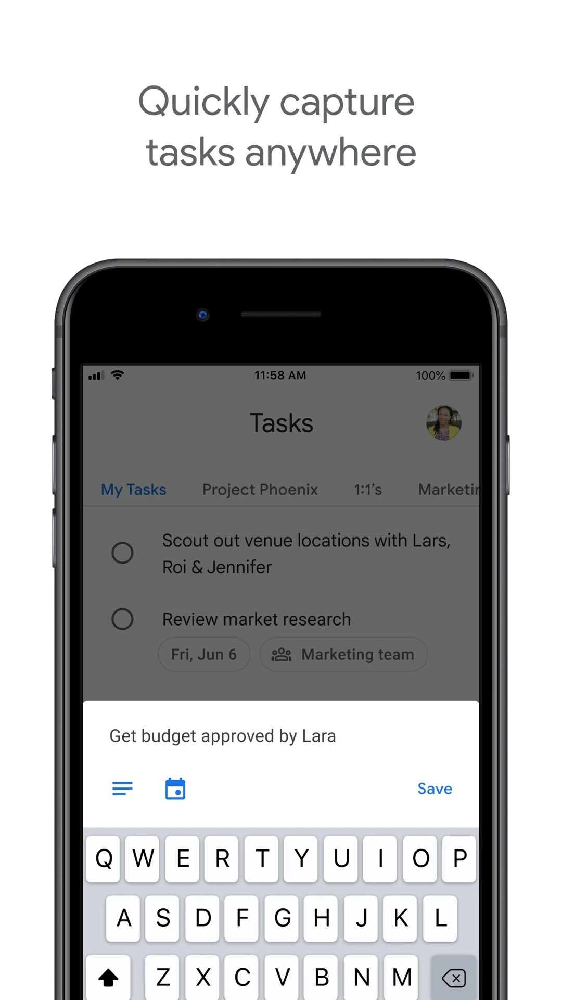{: width="180" .normal }
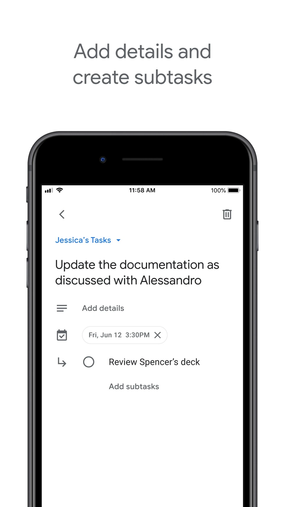{: width="180" .normal }

官方帮助中心给出的额度是：所有列表合计最多 10 万条任务，单个列表最多 2 万条未完成任务。它子任务只有一层、子任务不带独立日期，也没有优先级、看板或统计；子任务存在时还不能使用重复规则。它随 Google 账号免费提供，谈不上数据本地化，也谈不上复杂组织——它的定位就是「在邮件旁边顺手记一笔」。

### Any.do：把任务放进当天日程

Any.do 把清单和日历放在同一屏里，强调「今天要做什么」而不是「总共有多少任务」；此外还有每日计划、共享任务与协作看板、跨设备同步，以及面向小团队的付费档位。

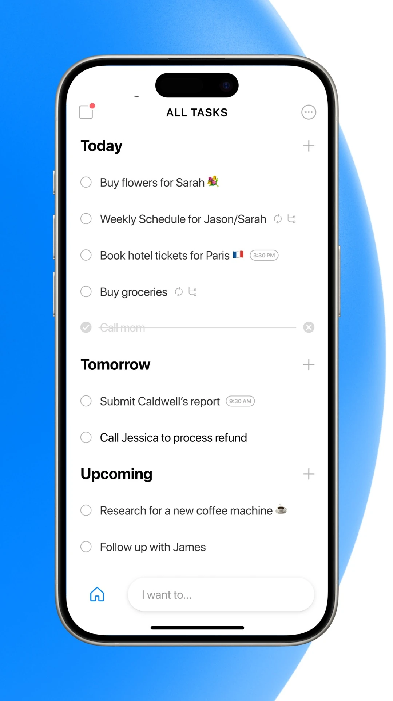{: width="180" .normal }
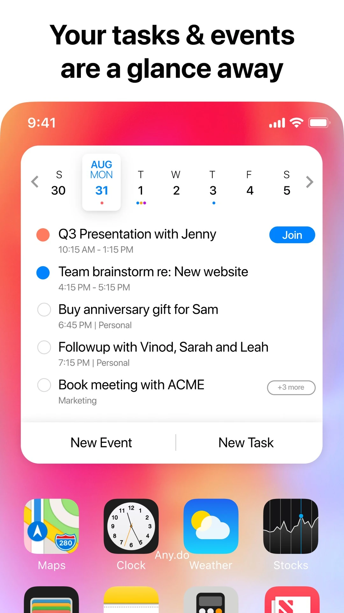{: width="180" .normal }

它与 Microsoft To Do 一样偏「日程化」，但更强调协作与订阅增值；免费版可用，具体权益与价格按官方定价页当下口径为准。若你主要是一个人用、且不打算把清单搬进订阅体系，需要先确认哪些能力落在免费档。

## 五、同一条任务，在 7 款里会变成什么

把开头的那句「下周三交季度报表」原样丢进去，差异可以压成一张表：

| 产品 | 输入时发生什么 | 落在哪个容器 | 过了下周三 | 打勾之后 | 数据在哪 |
|---|---|---|---|---|---|
| 喵窝清单 | 纯文本标题，日期 / 优先级 / 标签 / 重复分面板设置 | 一层清单 + 多层标签 + 一层子任务 | 归入「已过期」并标出，不自动顺延 | 进「已完成」并记录完成时间；无回收站 | 本机；整库备份到 Google Drive / WebDAV，CSV 导出为会员项 |
| Todoist | 智能快速添加可解析日期与项目 | 项目 + 子任务 + 标签 + 过滤器 | 保留未完成任务，日历布局属付费 | 留活动历史（免费 1 周），效率可视化 | 账号云同步 |
| TickTick | 自然语言输入，可设提醒与重复 | 清单 + 看板 + 优先级矩阵 | 日历视图里可见，可配专注与番茄钟 | 完成记录 + 习惯 / 专注统计 | 账号跨平台同步 |
| Microsoft To Do | 手动添加或从 Outlook 标记邮件生成 | 平铺列表 + 步骤 | 未完成任务进入次日「建议」 | 留在列表，可标记完成 | Exchange / 微软账号同步 |
| Things 3 | 快速添加可带备注、子任务与提醒 | 区域 → 项目 → 标题 | 留在 Upcoming 时间线里 | 进 Logbook 完成记录 | 仅 Apple 设备，Things Cloud 同步 |
| Google Tasks | 从 Gmail / 日历 / Chat / Docs 侧边栏记一笔 | 平铺列表 + 一层子任务 | 带日期任务显示在日历上 | 标记完成后留在列表 | Google 账号 |
| Any.do | 手动添加，可放进当天计划 | 清单 + 日历视图 + 共享看板 | 日历同屏可见 | 完成状态 + 每日计划回顾 | 账号跨设备同步 |

这张表刻意只比较「一条任务的去向」。功能数量、界面风格、模板多不多，都不影响这条任务会不会在需要的时候被重新看见。

## 六、平台、付费与数据归属

| 产品 | 主要平台 | 付费口径（2026-11 官方页面） | 需要账号 | 数据 / 导出 |
|---|---|---|---|---|
| 喵窝清单 | Android / iOS | 免费限 10 清单 / 10 标签 / 单任务 10 子任务；深色主题、应用锁、无限额度、CSV 导出为解锁项 | 否 | 本机；整库备份可指向自建 WebDAV；无导入 |
| Todoist | Web / iOS / Android / 桌面 | 免费 5 个私人项目；专业版年付 US$60、月付 US$7；商务版按人计费 | 是 | 云同步；自动备份属付费 |
| TickTick | 全平台（含 Web、手表） | 免费 9 清单 / 每清单 99 任务；Premium US$49.99/年 | 是 | 跨平台同步 |
| Microsoft To Do | iPhone / Android / Windows / Web | 免费，无独立付费档 | 是（微软账号） | Exchange 同步，随 Microsoft 365 生态 |
| Things 3 | 仅 iPhone / iPad / Mac / Apple Watch | 按平台一次性买断，无订阅 | 否 | Things Cloud 同步自家设备 |
| Google Tasks | Gmail / 日历 / Chat / Docs + 移动应用 | 随 Google 账号免费 | 是 | Google 账号；合计 10 万条上限 |
| Any.do | iPhone / Android / Mac / Windows / Web | 免费档 + 订阅档（以官方定价页为准） | 是 | 跨设备同步 |

## 七、先找出你卡在哪一段

别从「哪款最好」开始选，先看这五段里你最常在哪一段掉链子：

- **总忘记记下来**：优先看入口。自然语言快速添加（Todoist、TickTick）、Gmail 侧边栏（Google Tasks）、桌面快速添加小组件（喵窝清单）都能把成本压到几秒。
- **记了但找不到**：问题在第二段。长期项目选 Things 3 或 Todoist；只要简单分组，平铺列表或一层清单就够，不必为用不上的层级付学习成本。
- **记了却没在做**：问题在第三段。每天重排「我的一天」（Microsoft To Do）、日历同屏（Any.do、TickTick）、把逾期明确标出来（喵窝清单）是三种不同解法。
- **做完就查不到痕迹**：看第四、五段。需要完整历史选 Todoist 付费档或 Things 3 的 Logbook；喵窝清单没有回收站，删除不可恢复，这一点要提前知道。
- **在意数据归属**：不想注册、想自己备份，喵窝清单与 Things 3（仅 Apple）是两端；换设备频繁、要实时同步，账号云同步的产品更省事。

还拿不定主意，可以先读 [喵窝清单新手入门](/zh/posts/best-meow-todo-list-android/) 与 [喵窝清单完整教程](/zh/posts/tutorial-meow-todo-list/)；如果更看重离线使用、纯本地数据与桌面小组件，[喵窝清单应用页](/zh/apps/meow-todo-list/) 里能看到更完整的功能说明。

## 八、六个常见误区

1. **「功能越多越能坚持」**：番茄钟、习惯、看板、协作确实有用，但每多一个模块就多一处需要维护的地方。先用一两周确认自己卡在哪一段，再决定要不要更重的工具。
2. **「写完清单就等于推进了」**：Masicampo 与 Baumeister 的结论是「具体计划」降低侵入性思绪，不是「列清单」等于完成任务。条目里最好带上下一步动作，而不只是名词。
3. **「逾期了就该自动挪到今天」**：自动顺延会让「漏了几天」这件事在统计里消失。明确标出逾期更适合需要复盘的人；每天重排更适合不想被旧账压住的人，两者别混着用。
4. **「免费版都能随便建任务」**：限制可能落在清单数（喵窝清单 10、TickTick 9）、项目数（Todoist 5）、每清单任务数（TickTick 99），也可能落在子任务或历史长度上。看清限制对象再判断够不够用。
5. **「本地就是不安全 / 云就是更方便」**：本地没有实时同步，换设备要靠备份文件，但记录不经服务器；云同步省心，代价是账号与数据托管。这是取舍，不是优劣。

6. **「重复任务和连续打卡是一回事」**：习惯应用里「每天读书」是同一个目标在不同周期的完成情况，断一天会影响连续次数；清单应用里「每月 1 号交房租」每完成一次就派生出一条新任务，彼此是独立记录。把两者混用，统计口径会失去意义。

## 九、官方下载地址

下面只列各家自己的商店页面，不经过第三方下载站。Google Play 链接已逐个打开页面核对应用名，App Store 链接的应用 ID 已用 Apple 官方 Lookup 接口核对应用名称与开发者（核对时间 2026 年 11 月）；应用改名或调整上架地区时，请以商店搜索结果为准。

- **喵窝清单（Meow Todo List）**：[Google Play](https://play.google.com/store/apps/details?id=com.glgjing.money.task.todo.list.meow) · [App Store](https://apps.apple.com/app/id6742345495)
- **Todoist**：[Google Play](https://play.google.com/store/apps/details?id=com.todoist) · [App Store](https://apps.apple.com/app/id572688855)
- **TickTick（滴答清单）**：[Google Play](https://play.google.com/store/apps/details?id=com.ticktick.task) · [App Store](https://apps.apple.com/app/id626144601)
- **Microsoft To Do**：[Google Play](https://play.google.com/store/apps/details?id=com.microsoft.todos) · [App Store](https://apps.apple.com/app/id1212616790)
- **Things 3**：[App Store](https://apps.apple.com/app/id904237743) · [官网](https://culturedcode.com/things/)；仅 Apple 生态，**没有 Android 版**
- **Google Tasks**：[Google Play](https://play.google.com/store/apps/details?id=com.google.android.apps.tasks) · [App Store](https://apps.apple.com/app/id1353634006)
- **Any.do**：[Google Play](https://play.google.com/store/apps/details?id=com.anydo) · [App Store](https://apps.apple.com/app/id497328576)

## 十、常见问题（FAQ）

**清单应用、待办清单、任务管理应用是同一类东西吗？**
{:.faq-q}

大体是同一类产品，只是叫法侧重不同：核心都是「一条任务 + 完成状态 + 什么时候再被看见」。真正需要分清的是它和另外三类工具的边界——日历管有明确起止时刻的时间块，习惯应用管按周期反复出现、没有终点的行为，笔记管可长期修改的内容，而清单管的是**做完就结束**的事。把四类东西塞进同一个工具，往往是清单开始失控的第一步。

**一条任务该写多细？每条都要拆子任务吗？**
{:.faq-q}

判断标准很简单：看到它能不能直接动手。「准备季度汇报」通常要拆成几个动作，「回张三邮件」则不必。子任务在多数产品里只有一层、且本身不带独立日期（Google Tasks 官方说明如此），更适合当步骤清单而不是嵌套项目；喵窝清单的免费档单条任务最多 10 个子任务，超出需要解锁。与其给每条任务都拆步骤，不如只拆那些让你一直拖着没开始的。

**重复任务完成后，下一条是怎么来的？**
{:.faq-q}

以喵窝清单为例：勾选完成当前这条时，会生成一条**全新的下一条**，把标题、备注、清单、标签、优先级、重复规则连同子任务一起复制过去，子任务重置为未完成，计划时间跳到下一个有效周期；中间已经过去、没来得及处理的周期会被跳过，直接落在当天或未来，可按日期或按次数结束。原来那条则变成已完成、不再重复。因此历史是一条条真实完成过的记录，而不是同一条任务被反复改写。

**日期过了还没做完，任务会自动挪到今天吗？**
{:.faq-q}

不一定，这恰恰是各家差别最大的地方。喵窝清单不会自动顺延，逾期任务单独归入「已过期」并标出，同时被今天视图带出来；Microsoft To Do 的「我的一天」每天从空白开始，今天没做完的会进入次日的「建议」。前者是台账，适合需要复盘的人；后者是每天重排，适合不想被旧账压住的人。选之前想清楚自己更怕漏掉还是更怕被压住。

**换手机之后，之前记的任务还在吗？**
{:.faq-q}

看数据放在哪。喵窝清单是纯本地、无需账号，换设备要靠整库备份与恢复，支持 Google Drive 或自己填写的 WebDAV 地址，还可设置自动备份；按清单、标签、优先级与日期区间筛选后导出 CSV 属于会员功能，且没有对应的导入。Todoist、TickTick、Microsoft To Do、Google Tasks、Any.do 走账号云同步，换设备更省心；Things 3 通过 Things Cloud 在自家 Apple 设备间同步。无论哪种，换机前先确认备份或同步确实跑过一次。

**免费版够用吗？一般限制在哪里？**
{:.faq-q}

限制对象不一样，别只数「能建多少条任务」。喵窝清单限 10 个清单、10 个标签、单条任务 10 个子任务，**任务总数不限**；TickTick 官方写明免费 9 个清单、每清单 99 条任务；Todoist 免费 5 个私人项目、3 个过滤器、1 周活动日志，日历布局与自动备份在付费档；Google Tasks 官方给的是所有列表合计 10 万条、单列表 2 万条未完成。先看看自己最容易撞到哪一项，再判断要不要付费。

**能直接写「下周三 15:00 交报表」让应用自己解析吗？**
{:.faq-q}

看产品。Todoist 与 TickTick 都把自然语言快速添加列进免费能力，一句话可带出日期与重复规则；喵窝清单没有自然语言解析，标题是纯文本，日期、优先级、标签、重复分别由独立面板选择，好处是没有解析歧义、写什么就存什么。另外它的提醒时刻等同于任务的计划时间，没有「提前 10 分钟提醒」这样的独立设置，另有每天固定时间的汇总提醒。

**不联网、不注册账号能用吗？**
{:.faq-q}

喵窝清单可以，任务、清单、标签都保存在设备上，离线可用；代价是没有多设备实时同步，换设备得靠备份文件。Things 3 也不需要账号，但只限 Apple 设备。其余几款都以账号为入口，离线时通常仍能暂时查看或编辑，完整功能依赖登录后的同步。想完全本地化，还要顺带确认导出与备份是否可用——这决定了几年后能不能把数据带走。

## 十一、延伸阅读与术语索引

- [安卓清单与任务管理应用全景（2026）](/zh/posts/pillar-todo-list-task-manager-apps-android/)
- [喵窝清单 vs Todoist：差别到底在哪](/zh/posts/vs-meow-todo-and-todoist/)
- [喵窝清单新手入门](/zh/posts/best-meow-todo-list-android/)
- [喵窝清单完整教程](/zh/posts/tutorial-meow-todo-list/)
- [术语：什么是子任务](/zh/glossary/what-is-a-subtask/)
